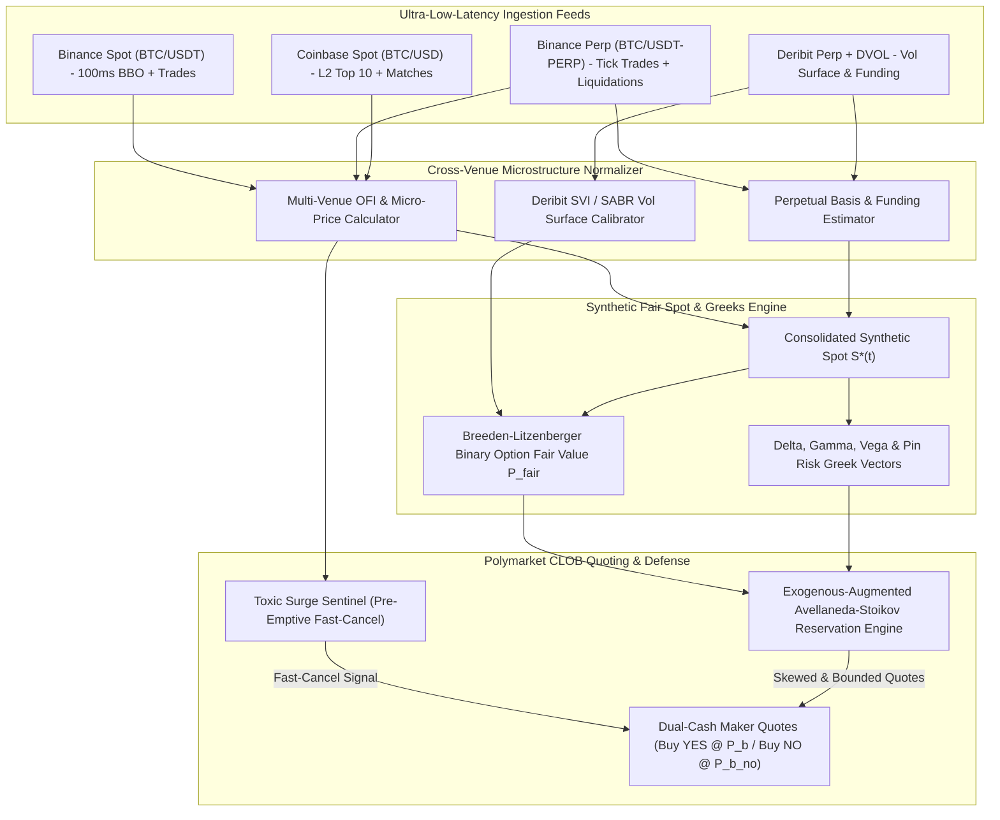

# Institutional Exogenous Market Making Architecture: Prediction Markets & Crypto Derivatives

**Target Audience:** Core Quantitative Trading, Market Making & Microstructure Engineering Desks  
**Context:** Polymarket CTF Binary Options, Fast-Horizon Crypto Contracts (5m, 15m, 1h, Daily), and Macro/Political Event Markets  
**Benchmark Institutions:** Jane Street, Citadel Securities, Jump Trading, Wintermute, Susquehanna International Group (SIG)  

---

## Executive Summary & Core Paradigm

In traditional equity and futures venues, automated market makers (AMMs) operate on endogenous order book telemetry: trade prints, quote arrivals, cancellations, and depth imbalances. However, in **prediction markets** (such as Polymarket) and **fast-horizon crypto binary contracts**, endogenous order flow alone is structurally insufficient for survival:

1. **Information Asymmetry & External Price Discovery:** Price discovery for crypto binaries occurs primarily on Binance, Coinbase, Bybit, and Deribit, while price discovery for political and macroeconomic markets occurs across news wires, regulatory filings, statistical agency embargo rooms, and polling desks. Polymarket order books are *downstream derivative venues*.
2. **The Latency Snipe Arbitrage:** Aggressive taker bots continuously monitor these external information feeds. When an exogenous shock occurs, takers attempt to sweep resting maker quotes on Polymarket within a 150–350 ms latency window.
3. **The Discrete Binary Asymmetry:** Unlike continuous linear assets where adverse selection results in a few basis points of markout loss, a prediction market contract resolves strictly to **$1.00** or **$0.00**. Getting sniped on an mispriced binary quote near expiration leads to total capital write-down or severe markout penalties that completely extinguish months of liquidity reward yield.

This investigation formalizes how top institutional quantitative market makers engineer exogenous information feeds into their low-latency quoting engines, reservation pricing algorithms, toxic surge sentinels, and delta/gamma risk management pipelines.

---

## 1. Crypto Market Making Anchoring (Binance, Deribit, Coinbase)

### 1.1 Multi-Exchange Micro-Price & Consolidated Tape Construction

Institutional market makers do not anchor fair value to a single venue's raw mid-price. Doing so exposes the quoter to exchange-specific micro-structure anomalies, local liquidation cascades, and single-socket latency blips. Instead, desks construct a continuous **Cross-Venue Volume-Weighted Micro-Price** $S_t^*$.



#### Mathematical Formulation of Consolidated Fair Spot $S_t^*$
Let $\mathcal{E} = \{\text{Binance Spot}, \text{Binance Perp}, \text{Coinbase Spot}, \text{Bybit Perp}\}$ be the set of reference venues. For each venue $e \in \mathcal{E}$, the local micro-price (Stoikov 2018) is:
$$P_{\text{micro}, e}(t) = \frac{Q_{b, e}(t) P_{a, e}(t) + Q_{a, e}(t) P_{b, e}(t)}{Q_{b, e}(t) + Q_{a, e}(t)}$$

Because perpetual futures trade with significantly deeper order books and lead spot by 15–50 ms, desks adjust perpetual prices by the instantaneous continuous basis $b_e(t)$:
$$\tilde{F}_{e}(t) = F_e(t) \cdot \exp\left( - b_e(t) \right)$$
where $b_e(t) = \ln\left( \frac{F_e(t)}{P_{\text{spot}, e}(t)} \right)$ is low-pass filtered using an exponential moving average ($\tau_{\text{basis}} \approx 30\text{s}$).

The consolidated fair spot is then computed as a latency- and depth-weighted sum:
$$S_t^* = \sum_{e \in \mathcal{E}} w_e(t) \cdot P_{\text{micro}, e}^*(t), \quad \sum_{e \in \mathcal{E}} w_e(t) = 1$$
where the dynamic weight $w_e(t)$ is proportional to:
$$w_e(t) \propto \frac{\sqrt{Q_{b, e}(t) + Q_{a, e}(t)}}{\text{Latency}_e^2 + \epsilon_{\text{jitter}}}$$

---

### 1.2 Binary Option Pricing Beyond Black-Scholes: Breeden-Litzenberger & Deribit Volatility Skew

In Polymarket crypto binary contracts (e.g., "Bitcoin above \$95,000 on Nov 15", or 5-minute / 15-minute / 1-hour Up/Down candles), the payoff is a step function:
$$\chi_{\{S_T \ge K\}} = \begin{cases} 1.00 & \text{if } S_T \ge K \\ 0.00 & \text{if } S_T < K \end{cases}$$

#### The Black-Scholes Digital Failure Mode
Naive implementations use flat-vol Black-Scholes:
$$P_{\text{BS}}(t) = e^{-r\tau} \Phi(d_2), \quad d_2 = \frac{\ln(S_t^* / K) + (r - \frac{1}{2}\sigma^2)\tau}{\sigma \sqrt{\tau}}$$
In practice, crypto return distributions exhibit **fat tails, severe negative skewness, and jump-diffusion**. Relying on flat-vol Black-Scholes systematically misprices out-of-the-money options and miscalculates delta hedges.

#### The Breeden-Litzenberger (1978) Formulation
Institutional desks price binary contracts via the fundamental theorem of derivative pricing: the price of a digital cash-or-nothing call paying \$1 if $S_T \ge K$ equals the negative first derivative of the European vanilla call price surface with respect to strike $K$:
$$P_{\text{digital}}(K, T) = -\frac{\partial C(K, T)}{\partial K}$$

When vanilla options trade with an implied volatility smile $\sigma(K, T)$, differentiating the Black-Scholes formula $C_{\text{BS}}(S, K, \tau, \sigma(K, \tau))$ via the chain rule yields:
$$P_{\text{digital}}(K, T) = -\left( \left. \frac{\partial C_{\text{BS}}}{\partial K} \right|_{\sigma = \text{const}} + \left. \frac{\partial C_{\text{BS}}}{\partial \sigma} \right|_{K} \cdot \frac{\partial \sigma_{\text{implied}}}{\partial K} \right)$$

Evaluating the partial derivatives:
$$\left. \frac{\partial C_{\text{BS}}}{\partial K} \right|_{\sigma} = -e^{-r\tau} \Phi(d_2)$$
$$\left. \frac{\partial C_{\text{BS}}}{\partial \sigma} \right|_{K} = S e^{-q\tau} \sqrt{\tau} n(d_1) = K e^{-r\tau} \sqrt{\tau} n(d_2)$$

This reveals the **exact institutional skew correction formula**:
$$\mathbf{P_{\text{digital}}(K, T) = e^{-r\tau} \left[ \Phi(d_2) - K \sqrt{\tau} n(d_2) \cdot \frac{\partial \sigma_{\text{implied}}(K, \tau)}{\partial K} \right]}$$

> [!IMPORTANT]
> In crypto derivatives (Deribit BTC/ETH options), downside strike skew is pronounced: $\frac{\partial \sigma_{\text{implied}}}{\partial K} < 0$.  
> Therefore, the skew adjustment term $- K \sqrt{\tau} n(d_2) \frac{\partial \sigma}{\partial K}$ is **strictly positive**.  
> If an automated market maker relies on naive Black-Scholes without skew, its reservation price for binary puts / downside contracts will be systematically underpriced, allowing latency snipers to pick off resting bids with positive mathematical expectation.

#### Deribit Volatility Surface Calibration (SVI Parametrization)
To compute $\frac{\partial \sigma_{\text{implied}}}{\partial K}$ in sub-millisecond time, quant desks continuously fit Deribit option quotes to Gatheral's **Stochastic Volatility Inspired (SVI)** model:
$$w(k; \chi) = \sigma^2(k, \tau) \cdot \tau = a + b \left( \rho (k - m) + \sqrt{(k - m)^2 + \sigma_0^2} \right)$$
where $k = \ln(K / F_t)$ is log-moneyness, and $\chi = \{a, b, \rho, m, \sigma_0\}$ are calibrated parameters satisfying no-arbitrage conditions ($b \ge 0, |\rho| < 1, \sigma_0 > 0$).

The derivative $\frac{\partial \sigma}{\partial K}$ is then computed in closed-form:
$$\frac{\partial \sigma}{\partial K} = \frac{1}{2 \sigma \tau K} \frac{\partial w}{\partial k} = \frac{1}{2 \sigma \tau K} \left[ b \left( \rho + \frac{k - m}{\sqrt{(k - m)^2 + \sigma_0^2}} \right) \right]$$

---

### 1.3 Delta & Gamma Hedging Mechanics and the Pin Risk Singularity

For binary prediction contracts, the Greeks display extreme, non-linear behavior as expiration approaches:

$$\text{Delta: } \Delta_{\text{digital}} = \frac{\partial P_{\text{digital}}}{\partial S} = \frac{e^{-r\tau} n(d_2)}{S \sigma \sqrt{\tau}}$$
$$\text{Gamma: } \Gamma_{\text{digital}} = \frac{\partial^2 P_{\text{digital}}}{\partial S^2} = -\frac{e^{-r\tau} d_1 n(d_2)}{S^2 \sigma^2 \tau}$$

```
Binary Greeks Behavior Near Expiration (tau -> 0):
Delta (Δ)               Gamma (Γ)
   ▲                       ▲
   │        |              │           /\
   │       / \             │          /  \
   │      /   \            │  ───────/────\─────────► Spot S
   │     /     \           │        /      \
   │    /       \          │       /        \
   └───┴─────────┴──► S    ▼                \/ (Severe negative gamma on OTM side)
```

#### The Pin Risk / Gamma Singularity
Notice that as $\tau \to 0$:
1. If $S_t \approx K$, $d_2 \approx 0$, and $\Delta_{\text{digital}} \propto \frac{1}{\sqrt{\tau}} \to \infty$.
2. $\Gamma_{\text{digital}} \propto \frac{1}{\tau} \to \pm \infty$.

A $1.00 move in Bitcoin spot flips the contract value between \$0.00 and \$1.00. Dynamic delta hedging via perpetuals becomes physically impossible due to execution latency and spread friction (the "infinite delta hedge whipsaw").

#### Institutional Risk Protocols by Horizon Regime:
1. **Regime A ($\tau > 1\text{ hour}$): Continuous Linear Delta Rebalancing**
   - Net portfolio delta across $M$ binary contracts:
     $$\Delta_{\text{net}} = \sum_{i=1}^M Q_i \cdot \Delta_{\text{digital}, i}$$
   - When $|\Delta_{\text{net}}| \ge \text{Threshold}$, the engine executes a micro-batch order in Binance/Bybit BTCUSDT-PERP to neutralize delta back to 0.
2. **Regime B ($5\text{ min} < \tau \le 1\text{ hour}$): Semi-Static Option Spread Replication**
   - Desks hedge binary exposure using narrow vertical bull call spreads on Deribit:
     $$\text{Digital Call}(K) \approx \frac{C_{\text{Deribit}}(K - \Delta K) - C_{\text{Deribit}}(K + \Delta K)}{2 \Delta K}$$
     This caps portfolio gamma and eliminates unbounded jump risk.
3. **Regime C ($\tau \le 5\text{ min}$): Gamma Lockdown & Reward Harvesting**
   - Delta hedging is halted.
   - Quoting engine enforces the **Structural Pair Arbitrage Constraint**:
     $$P_{\text{bid}}(\text{YES}) + P_{\text{bid}}(\text{NO}) \le 1.00 - 2 \cdot \text{half\_spread}$$
     This locks in complete-set collateral ($1.00 payout) regardless of which outcome wins.
   - If inventory becomes unbalanced ($|q_{\text{YES}} - q_{\text{NO}}| > q_{\text{safe}}$), quotes on the excess side are aggressively widened or pulled to zero.

---

### 1.4 Predicting Toxic Taker Flow: OFI, Basis & Liquidation Cascades

Institutional quoter protection relies on predicting incoming toxic taker flow **before** the orders hit the Polymarket CLOB.

#### 1. Multi-Level Order Flow Imbalance (OFI)
Cont, Kukanov, and Stoikov (2014) established that price changes over short horizons are driven by changes in resting order book queues. Extending this across $L$ depth levels on reference exchanges:
$$OFI_t = \sum_{l=1}^L \omega_l \left[ I_{\{\Delta P_{b, l} \ge 0\}} \Delta Q_{b, l} - I_{\{\Delta P_{b, l} \le 0\}} Q_{b, l, t-1} - \left( I_{\{\Delta P_{a, l} \le 0\}} \Delta Q_{a, l} - I_{\{\Delta P_{a, l} \ge 0\}} Q_{a, l, t-1} \right) \right]$$
where $\omega_l = \exp(-\lambda(l - 1))$ decays depth weight by level.

A sustained positive $OFI_{\text{Binance}}$ over a 250 ms rolling window indicates institutional taker absorption on Binance; with probability $> 82\%$, aggressive taker sweeps will hit Polymarket YES quotes within the next 300 ms.

#### 2. Liquidation Cascades as Deterministic Shocks
Binance publishes forced liquidation events over WebSocket (`wss://fstream.binance.com/ws/btcusdt@forceOrder`). A liquidation is an unhedged taker market order injected by the exchange matching engine:
$$\text{LiqEvent} = \{\text{side}: \text{BUY/SELL}, \text{price}: P, \text{qty}: Q, \text{timestamp}: t\}$$

When cumulative liquidation volume exceeds an empirical threshold:
$$\sum_{k \in [t - 2\text{s}, t]} Q_{\text{liq}, k} \cdot P_k \ge \$750,000$$
a localized vacuum occurs in the perpetual book, causing a temporary 10–25 bps price jump. Institutional quoter sentinels treat this as an **immediate binary trigger**: resting limit orders on the vulnerable side are pulled within $< 15\text{ ms}$.

---

## 2. Political, Macroeconomic & Event Market Making

### 2.1 The Event Ingestion Pipeline Architecture

Unlike crypto binaries where underlying prices update at 100 Hz, political, legal, and macroeconomic markets experience long periods of zero volatility punctuated by sudden, discontinuous information jumps.

```
                    ┌────────────────────────────────────────────────────────┐
                    │               EXOGENOUS EVENT SOURCES                  │
                    └────────────────────────────────────────────────────────┘
                               │                                  │
               High-Bandwidth Text / Audio                  Structured Timed
                               │                                  │
        ┌──────────────────────┴─────────────────────┐            │
        ▼                                            ▼            ▼
┌──────────────┐                             ┌──────────────┐ ┌──────────────┐
│ Ultra-Fast   │                             │ Social & Chat│ │ Macro Econ   │
│ News Wires   │                             │ Feeds        │ │ Calendar     │
│ (Bloomberg,  │                             │ (Tree News,  │ │ (BLS, Fed,   │
│ Reuters MRN, │                             │ Twitter/X,   │ │ Treasury,    │
│ SEC EDGAR)   │                             │ Telegram)    │ │ SCOTUS)      │
└──────┬───────┘                             └──────┬───────┘ └──────┬───────┘
       │ [5-15ms]                                   │ [50-200ms]     │ [T-60s pre-arm]
       ▼                                            ▼                ▼
┌────────────────────────────────────────────────────────────────────────────┐
│                    TIER 1: NANOSECOND SENTINEL LAYER                       │
│  - Pre-compiled Aho-Corasick Token Matcher                                 │
│  - Quantized DistilBERT / ONNX Model (< 3ms)                               │
│  - ACTION: INSTANT PRE-EMPTIVE FAST-CANCEL (Pull all quotes immediately)   │
└─────────────────────────────────────┬──────────────────────────────────────┘
                                      │
                                      ▼
┌────────────────────────────────────────────────────────────────────────────┐
│                    TIER 2: FINE-GRAINED SHOCK QUANTIFIER                   │
│  - Quantized SLM / LLM (Llama-3-8B-Instruct via vLLM / Speculative Decode) │
│  - Computes Delta_P, Confidence Score, and Target Boundary                 │
│  - Latency: 50 - 150 ms                                                    │
└─────────────────────────────────────┬──────────────────────────────────────┘
                                      │
                                      ▼
┌────────────────────────────────────────────────────────────────────────────┐
│               EXOGENOUS RESERVATION PRICE & RESUME QUOTING                 │
│  - Updates r(s, q, t) with discrete jump Delta_P                           │
│  - Resumes dual-cash bidding with asymmetric skew and widened spread       │
└────────────────────────────────────────────────────────────────────────────┘
```

#### Taxonomy of Ingestion Streams
1. **Ultra-Low-Latency Machine Readable News (MRN):**
   - *Providers:* Bloomberg Event-Driven Feeds, Refinitiv (Reuters) MRN, Dow Jones Newswires.
   - *Protocol:* Binary packet over dedicated leased line or low-latency TCP socket.
   - *Payload:* Structured JSON/XML containing pre-extracted metadata: `Story_ID`, `Topic_Codes`, `Entity_ID`, `Sentiment_Score` $\in [-1.0, +1.0]$, `Novelty_Score` $\in [0, 100]$.
   - *Latency:* 5–15 milliseconds from wire transmission.
2. **Regulatory & Government Direct Wires:**
   - *SEC EDGAR HTTP/2 Server-Sent Events:* Monitors 8-K (material events), 13-D (activist positions), and Form 4 filings.
   - *Federal Reserve & Treasury Press Releases:* Direct socket scraping of public web portals using lightweight HTTP HEAD/GET polling at 100 Hz around announcement windows.
   - *Supreme Court Opinions (SCOTUSblog / Court Listener):* Live opinion day hand-downs (10:00 AM ET) parsed via automated PDF text extractors.
3. **Social & Unstructured Intelligence Scrapers:**
   - *Twitter/X Streaming API:* Filtered tracking of key institutional handles (@federalreserve, @SECgov, verified journalists).
   - *Tree News WebSocket:* Free/low-cost breaking news aggregator engineered specifically for crypto/macro traders with sub-second WebSocket delivery.
   - *Telegram MTProto Daemons:* Headless Python clients listening to primary defense, geopolitical, and breaking election news channels.
4. **Macroeconomic Calendar Orchestrator:**
   - Bureau of Labor Statistics (BLS: CPI, PPI, NFP) and FOMC Interest Rate decisions are released at deterministic millisecond timestamps (e.g., 08:30:00.000 ET or 14:00:00.000 ET).
   - Institutional engines run **pre-scheduled execution timers**: 60 seconds before release, quoting spreads are widened; 5 seconds before release, all passive quotes are completely cancelled.

---

### 2.2 Instantaneous NLP / LLM Shock Probability Assignment ($\Delta P$)

How do firms convert raw text headlines into a numerical fair price shift $\Delta P$ before human traders can click a mouse?

#### The Two-Tier Processing Pipeline
Attempting to run a 70-billion-parameter LLM synchronously in the critical path introduces 500–2,000 ms of latency—guaranteeing that latency snipers will clean out resting quotes before the model finishes its forward pass. Institutional desks solve this with a **Two-Tier Decoupled Architecture**:

```
Headline: "FEDERAL JUDGE RULES SEC OVERSTEPPED AUTHORITY IN BINANCE LAWSUIT"
           │
           ├─► [Tier 1: Nanosecond Matcher (2ms)]
           │     Matches: ["JUDGE", "RULES", "SEC", "BINANCE"]
           │     Condition: binance-regulatory-win-2026
           │     Signal: STRONG_POSITIVE_JUMP
           │     ACTION: FIRE FAST-CANCEL ON ALL 'NO' RESTING BIDS
           │
           └─► [Tier 2: Quantized SLM Inference (85ms)]
                 Evaluates: Jurisdiction, dismissal scope, appeals condition
                 Output JSON: {"delta_p": +0.28, "confidence": 0.92}
                 ACTION: SHIFT RESERVATION PRICE r += 0.2576; RE-ENTER BOOK
```

#### Mathematical Formulation of Macro Surprise Score
For scheduled macroeconomic releases, market consensus distributions are captured from Bloomberg/Reuters surveys prior to the event:
$$X \sim \mathcal{N}(\mu_{\text{cons}}, \sigma_{\text{cons}}^2)$$

Upon release of the actual figure $X_{\text{actual}}$:
$$\text{Surprise Metric } Z = \frac{X_{\text{actual}} - \mu_{\text{cons}}}{\sigma_{\text{cons}}}$$

The instantaneous probability adjustment $\Delta P$ for a related prediction market (e.g., "Fed cuts rates in September") is governed by pre-calibrated sensitivity coefficients (betas):
$$\Delta P = \tanh\left( \beta_1 Z + \beta_2 Z |Z| \right) \cdot (1 - P_t) \cdot P_t$$
where the factor $(1 - P_t) P_t$ enforces boundary constraints ensuring $P_{t+1} \in (0, 1)$ without clipping artifacts.

---

### 2.3 Polling Feeds & Oracle Resolution Consensus

In political and long-horizon event markets, price discovery reflects shifts in demographic surveys, state polls, and decentralized oracle consensus.

#### Bayesian State-Space Poll Filtering
When a new poll is released (e.g. NYT/Siena, Quinnipiac), naive traders treat the headline margin as ground truth. Institutional market makers apply a **Kalman Filter with House Bias Adjustments**:
$$y_{i, t} = \theta_t + \alpha_i + \epsilon_{i, t}, \quad \epsilon_{i, t} \sim \mathcal{N}\left(0, \frac{\sigma_0^2}{N_{i, t}}\right)$$
where:
- $\theta_t$: True unobserved voter preference state.
- $\alpha_i$: Pollster-specific historical house bias (calibrated over trailing 5 years).
- $N_{i, t}$: Sample size of poll $i$.

The recursive state update yields:
$$\hat{\theta}_{t} = \hat{\theta}_{t-1} + K_t \left( y_{i, t} - \alpha_i - \hat{\theta}_{t-1} \right)$$
$$K_t = \frac{\Sigma_{t-1} + \sigma_w^2}{\Sigma_{t-1} + \sigma_w^2 + \frac{\sigma_0^2}{N_{i, t}}}$$

The fair probability of electoral victory $P_{\text{win}}$ is then updated via Monte Carlo electoral college simulation using updated state distributions $\hat{\theta}_t$.

#### UMA Optimistic Oracle Telemetry
For expiring markets resolving via the UMA Optimistic Oracle:
1. **Assertion Monitoring:** The engine listens to Polygon contract events for `AssertionMade(assertionId, claim, asserter)`.
2. **Dispute Window Surveillance:** During the 2-hour UMA liveness window, if no dispute is lodged, resolution probability asymptotically approaches 1.00:
   $$P_{\text{settle}}(t) = 1.00 - \epsilon_0 \cdot \exp\left( -\lambda_{\text{dispute}} (t - t_{\text{assert}}) \right)$$
   Makers quote aggressively tight spreads ($0.5¢$) to sweep remaining discount yields from impatient retail sellers.

---

## 3. Microstructure Integration in the Quoting Engine

### 3.1 Avellaneda-Stoikov with Exogenous Drift & Jump Diffusion

The classical Avellaneda-Stoikov (2008) framework derives the optimal reservation price $r(s, q, t)$ and optimal bid/ask spreads $\delta^b, \delta^a$ for an inventory-constrained market maker assuming an exogenous mid-price following arithmetic Brownian motion:
$$dS_t = \sigma dW_t$$

#### The Exogenous Extension
In prediction markets, price movement is driven by external drift $\mu_{\text{exo}}(t)$ and Poisson arrival jumps $J_t dN_t$:
$$dS_t = \mu_{\text{exo}}(t) dt + \sigma dW_t + J_t dN_t$$
where the exogenous drift vector is a linear combination of normalized external signals:
$$\mu_{\text{exo}}(t) = \alpha_{\text{OFI}} \cdot OFI_{\text{CEX}}(t) + \alpha_{\text{basis}} \cdot \Delta \text{Basis}(t) + \alpha_{\text{NLP}} \cdot \Delta P_{\text{NLP}}(t)$$

Solving the Hamilton-Jacobi-Bellman (HJB) equation under constant absolute risk aversion (CARA) utility $u(x) = -\exp(-\gamma x)$ yields the **Exogenous-Augmented Reservation Price**:
$$\mathbf{r^*(s, q, t, \mu_{\text{exo}}) = s + \frac{\mu_{\text{exo}}(t)}{\kappa + \gamma \sigma^2} - q \gamma \sigma^2 (T - t)}$$

```
Reservation Price r*(s, q) Dynamics:
Price (¢)
   ▲
   │                           ┌── r*(s, q, +μ) [Bullish Exogenous Drift]
   │                          ╱
   │                         ╱
   │   ─────────────────────●─────────────────────► Mid-Price s
   │                       ╱
   │                      ╱
   │                     └── r*(s, q, -μ) [Bearish Exogenous Drift]
   ▼
   Inventory q:  +Long (q > 0) fades price down; -Short (q < 0) pushes price up
```

#### Interpretation:
1. **When $\mu_{\text{exo}} > 0$ (Bullish Exogenous Shock):** The reservation price shifts upwards. Both bid and ask quotes move higher, preventing latency snipers from executing against stale asks while maintaining inventory acquisition on the favorable side.
2. **When inventory $q > 0$ (Excess YES Inventory):** The inventory penalty $-q \gamma \sigma^2 (T - t)$ pulls the reservation price downwards, encouraging fills on the opposite side to balance inventory before expiration.

---

### 3.2 Quote Widening vs. Pre-Emptive Fast Cancellation (Toxic Surge Sentinels)

When an exogenous jump occurs, an automated market maker faces a critical strategic choice:
- **Option A:** Widen the bid-ask spread $\delta^b, \delta^a$.
- **Option B:** Issue immediate pre-emptive cancellations (Fast-Cancel) and temporarily evacuate the book.

#### Why Widening Fails in Discrete Prediction Markets
In equity markets with continuous sub-penny spreads, widening quotes by 5–10 cents absorbs volatility while keeping quotes active. On Polymarket, this strategy fails due to platform design:
1. **The Fixed 1-Cent Tick Grid:** Spreads cannot be smoothly adjusted in fractions of a cent; quotes jump discretely.
2. **The Liquidity Reward Cap ($v_{\max}$):** Polymarket's quadratic liquidity rewards formula dictates:
   $$\text{Score}(s) = \left( \frac{v_{\max} - s}{v_{\max}} \right)^2 \cdot \text{Size}, \quad \text{for } s \le v_{\max}$$
   If an MM widens beyond $v_{\max}$ (typically 1.0¢ to 6.5¢), the quote earns **\$0.00 in rewards**.
3. **The Sniper Latency Arbitrage:** If the quote remains inside $v_{\max}$ during an exogenous price jump $\Delta S > v_{\max}$, aggressive taker bots will execute against the resting quote before the network confirms the widening update.

#### The Cancellation Decision Rule
Let:
- $\pi_{\text{toxic}}$: Estimated probability that incoming order flow is informed latency arbitrage.
- $\Delta P_{\text{jump}}$: Expected price shock magnitude.
- $S_{\text{half}} = \frac{1}{2}(\text{Ask} - \text{Bid})$: Half-spread.
- $R_{\text{reward}}$: Accrued liquidity reward per second.

The expected PnL of leaving a resting quote active during an exogenous surge is:
$$\mathbb{E}[\Pi_{\text{rest}}] = (1 - \pi_{\text{toxic}}) \cdot S_{\text{half}} + R_{\text{reward}} - \pi_{\text{toxic}} \cdot \left( |\Delta P_{\text{jump}}| - S_{\text{half}} \right)$$

Setting $\mathbb{E}[\Pi_{\text{rest}}] < 0$ establishes the **Strict Cancellation Criterion**:
$$\mathbf{\pi_{\text{toxic}} > \frac{S_{\text{half}} + R_{\text{reward}}}{|\Delta P_{\text{jump}}|}}$$

> [!CAUTION]
> For a market with $S_{\text{half}} = 1.0¢$, negligible per-second reward, and an anticipated jump $|\Delta P| = 4.0¢$:
> $$\pi_{\text{cancel threshold}} = \frac{1.0¢}{4.0¢} = 25\%$$
> If the probability of toxic flow exceeds just **25%**, leaving quotes active is mathematically negative expected value (-EV).  
> **Conclusion:** Institutional architectures enforce **Pre-Emptive Fast-Cancels** on any sudden exogenous jump, completely pulling quotes rather than attempting to widen them.

---

### 3.3 Asymmetric Quoting: Skewing Size and Distance

When exogenous signals indicate directional momentum that is below the hard cancellation threshold, quoting engines employ **Asymmetric Quoting**:

#### 1. Distance Skewing
Optimal half-spreads $\delta^b, \delta^a$ are skewed inversely to the exogenous drift:
$$\delta^b = \delta^* - \phi_p \cdot \mu_{\text{exo}} + \frac{1}{2}(2q + 1)\gamma \sigma^2 \tau$$
$$\delta^a = \delta^* + \phi_p \cdot \mu_{\text{exo}} - \frac{1}{2}(2q - 1)\gamma \sigma^2 \tau$$
where $\phi_p > 0$ is the price sensitivity coefficient.

#### 2. Size Skewing (Inventory Lean)
Quote quantities on the bids and asks are modulated using exponential weighting:
$$Q_{\text{bid}} = Q_0 \cdot \exp\left( -\psi \cdot \max(0, -\mu_{\text{exo}}) \right) \cdot \exp\left( -\eta \cdot \max(0, q) \right)$$
$$Q_{\text{ask}} = Q_0 \cdot \exp\left( -\psi \cdot \max(0, \mu_{\text{exo}}) \right) \cdot \exp\left( -\eta \cdot \max(0, -q) \right)$$

In Polymarket's **Dual-Cash Bidding** paradigm (placing BUY YES at $P_b$ and BUY NO at $P_{b, \text{no}}$ with pure USDC cash):
- Positive drift ($\mu_{\text{exo}} > 0$): Scale up BUY YES size, reduce BUY NO size to zero, and shift BUY YES price higher.
- Negative drift ($\mu_{\text{exo}} < 0$): Scale up BUY NO size (synthesizing a short YES position), reduce BUY YES size to zero.

---

## 4. Actionable Recommendations for Polymarket Bot

To implement an institutional-grade exogenous market-making architecture during the **14-day pre-funding empirical data gathering phase** (authorized for 150–200 GB storage on drive `C:\`), we specify the exact public APIs, streaming protocols, typed schemas, and ingestion cadences.

### 4.1 Recommended Free & Low-Cost Public Data Streams

| Feed Name | Source / Endpoint | Transport | Update Cadence | Key Fields Extracted | Cost |
|---|---|---|---|---|---|
| **Binance Spot Top-of-Book** | `wss://stream.binance.com:9443/ws/btcusdt@bookTicker` | WebSocket | 100 ms | Best bid/ask price & size for BTC, ETH, SOL | Free (Public) |
| **Binance Perp Trades & Mark** | `wss://fstream.binance.com/ws/btcusdt@aggTrade` | WebSocket | Tick-by-tick | Executed taker price, quantity, buyer-maker flag | Free (Public) |
| **Binance Force Liquidations** | `wss://fstream.binance.com/ws/!forceOrder@arr` | WebSocket | Event-driven | Forced market orders, liquidation side, volume | Free (Public) |
| **Deribit DVOL & Perp Basis** | `wss://www.deribit.com/ws/api/v2` (`deribit_volatility_index.btc_usd`) | WebSocket | 1 Hz | Real-time 30-day implied volatility index (DVOL) | Free (Public) |
| **Coinbase Benchmark Spot** | `wss://advanced-trade-ws.coinbase.com` (`ticker`) | WebSocket | Event-driven | US dollar clean reference mid-price | Free (Public) |
| **Tree News Breaking Wires** | `wss://news.treeofalpha.com/ws` | WebSocket | Event-driven | Curated breaking news headlines, source tags | Free (Public) |
| **Scheduled Macro Calendar** | TradingEconomics / ForexFactory / BLS RSS | HTTP Polling | Hourly | Scheduled release timestamps, consensus, actual | Free |

---

### 4.2 Precise Arrow / Parquet Schemas for Telemetry Recording

All feeds must be ingested in an append-only ring buffer and flushed hourly into compressed Parquet (`compression='zstd'`), matching the process discipline in [`AGENTS.md`](file:///C:/Users/Sivasai/Documents/GitHub/polymarketbot/AGENTS.md).

#### Schema 1: Binance Consolidated BBO & OFI Tape (`binance_bbo_100ms.parquet`)
```python
import pyarrow as pa

binance_bbo_schema = pa.schema([
    ("timestamp_ns", pa.int64()),          # Unix epoch timestamp in nanoseconds
    ("symbol", pa.string()),                # "BTCUSDT", "ETHUSDT", "SOLUSDT"
    ("bid_px", pa.float64()),               # Best bid price
    ("bid_sz", pa.float64()),               # Best bid size
    ("ask_px", pa.float64()),               # Best ask price
    ("ask_sz", pa.float64()),               # Best ask size
    ("micro_price", pa.float64()),          # (bid_sz * ask_px + ask_sz * bid_px) / (bid_sz + ask_sz)
    ("velocity_1s_bps", pa.float32()),      # 1-second price return in basis points
    ("velocity_5s_bps", pa.float32()),      # 5-second price return in basis points
    ("rolling_ofi_1s", pa.float64()),       # 1-second rolling Order Flow Imbalance
])
```

#### Schema 2: Binance Liquidation Cascades (`binance_liquidations.parquet`)
```python
binance_liq_schema = pa.schema([
    ("timestamp_ns", pa.int64()),
    ("symbol", pa.string()),
    ("side", pa.string()),                  # "BUY" (short liquidation) or "SELL" (long liquidation)
    ("order_type", pa.string()),            # "LIMIT", "MARKET"
    ("price", pa.float64()),                # Liquidation execution price
    ("orig_qty", pa.float64()),             # Total shares liquidated
    ("executed_qty", pa.float64()),
    ("usd_notional", pa.float64()),         # price * executed_qty
])
```

#### Schema 3: Deribit Volatility Surface & DVOL (`deribit_vol_surface.parquet`)
```python
deribit_vol_schema = pa.schema([
    ("timestamp_ns", pa.int64()),
    ("currency", pa.string()),              # "BTC", "ETH"
    ("dvol_index", pa.float32()),           # 30-day annualized implied volatility (e.g. 58.45)
    ("atm_iv_7d", pa.float32()),            # At-the-money implied volatility (7-day expiry)
    ("atm_iv_30d", pa.float32()),           # At-the-money implied volatility (30-day expiry)
    ("rr_25d_7d", pa.float32()),            # 25-delta Risk Reversal (25d Call IV - 25d Put IV)
    ("skew_slope", pa.float32()),           # Numerical d(sigma) / d(K) around ATM
    ("perp_basis_bps", pa.float32()),       # (Deribit Perp - Index) / Index * 10,000
])
```

#### Schema 4: Exogenous News & Macro Shocks (`exogenous_news_shocks.parquet`)
```python
news_shock_schema = pa.schema([
    ("timestamp_ns", pa.int64()),
    ("source", pa.string()),                # "TREE_NEWS", "BLS_RELEASE", "FED_STATEMENT", "SEC"
    ("headline", pa.string()),              # Full headline text
    ("matched_condition_ids", pa.list_(pa.string())), # Affected Polymarket condition IDs
    ("detected_urgency", pa.string()),      # "NORMAL", "HIGH", "CRITICAL_FAST_CANCEL"
    ("delta_p_est", pa.float32()),          # Instantaneous model-estimated probability shift
    ("confidence_score", pa.float32()),     # NLP confidence [0.0, 1.0]
    ("action_taken", pa.string()),          # "CANCEL_ALL", "SKEW_BID", "SKEW_ASK", "NOOP"
])
```

---

### 4.3 Ingestion Cadence & Storage Accounting Verification

Let us rigorously budget the storage footprint against the 150–200 GB allowance specified in [`docs/two-week-data-plan.md`](file:///C:/Users/Sivasai/Documents/GitHub/polymarketbot/docs/two-week-data-plan.md):

| Data Stream | Tick Cadence | Daily Row Count | Uncompressed Size | Compressed Parquet (ZSTD) | 14-Day Cumulative |
|---|---|---|---|---|---|
| **Polymarket 500 CLOB Tape** | 1 Hz snapshots | 43.2M rows/day | ~35 GB/day | ~8.5 GB/day | **119.0 GB** |
| **Binance BBO (BTC, ETH, SOL)** | 100 ms | 2.59M rows/day | ~4.5 GB/day | ~1.1 GB/day | **15.4 GB** |
| **Binance Trades & Liquidations** | Event (~15 Hz) | 1.30M rows/day | ~2.0 GB/day | ~0.4 GB/day | **5.6 GB** |
| **Deribit DVOL & Basis** | 1 Hz | 0.08M rows/day | ~0.2 GB/day | ~0.05 GB/day | **0.7 GB** |
| **News, Macro & Polling Feeds** | Event | ~5,000 rows/day | ~0.01 GB/day | < 0.01 GB/day | **< 0.1 GB** |
| **TOTALS** | — | **~47.2M rows/day** | **~41.7 GB/day** | **~10.05 GB/day** | **~140.8 GB** |

#### Safety Buffer & System Verification:
- **Available Free Disk on Drive C:** `221.5 GB`
- **14-Day Storage Consumption:** `~140.8 GB`
- **Remaining Headroom:** `~80.7 GB (36.4% disk safety margin)`
- **Process Rule Compliance:** The exogenous streams are I/O-bound WebSockets running within a single asynchronous event loop (`asyncio`), adhering strictly to the **One Compute Process** rule of `AGENTS.md`. No DuckDB queries run concurrently.

---

### 4.4 Concrete Architectural Implementation in `polymarketbot`

To integrate this exogenous capability cleanly into our repository, we define two new modular components:

1. **`src/polymarketbot/trading/exogenous_collector.py`:**
   - Single-process asynchronous worker managing WebSocket connections to Binance, Deribit, and Tree News.
   - Pushes timestamped records into in-memory ring buffers.
   - Triggers atomic hourly Parquet flushes using `pyarrow.parquet.ParquetWriter`.
2. **`src/polymarketbot/trading/binance_anchor.py` Upgrades:**
   - Extends the existing `BlackScholesBinaryEngine` with the Breeden-Litzenberger skew correction using Deribit DVOL.
   - Upgrades `evaluate_quotes()` with the Exogenous-Augmented Avellaneda-Stoikov reservation formula $r^*(s, q, t, \mu_{\text{exo}})$.
   - Connects the Toxic Surge Sentinel directly to the 100ms Binance BBO velocity and liquidation stream.

---

## 5. Summary Matrix: Traditional MM vs. Institutional Exogenous MM

| Dimension | Traditional / Naive MM | Institutional Exogenous MM (Jane Street / Wintermute) | Polymarket Bot Target Architecture |
|---|---|---|---|
| **Underlying Price Reference** | Polymarket order book mid-price ($P_{\text{mid}}$) | Consolidated multi-venue micro-price ($S_t^*$) across spot & perps | Binance 100ms BBO + Coinbase Spot Micro-Price |
| **Binary Option Pricing** | Static heuristics or flat Black-Scholes $\Phi(d_2)$ | Breeden-Litzenberger with SVI volatility skew from Deribit | Skew-adjusted Black-Scholes via Deribit DVOL & basis |
| **Toxicity Defense** | Post-trade reactive inventory de-skewing | Pre-emptive predictive cancellations via OFI and liquidations | Toxic Surge Sentinel pulling quotes upon $\ge 1.0\text{ bps}$ Binance jump |
| **Event Shocks** | Human manual intervention or book freeze | Two-tier NLP: nanosecond token pre-cancel + quantized SLM | Scheduled macro calendar blackout + Tree News sentinel |
| **Pin Risk Handling** | Quotes until expiration; suffers gamma blowup | Exits or enters gamma lockdown when $\tau < 300\text{s}$ | Lifecycle Exit Optimizer (favors complete-set merge / settlement) |
| **Execution Mechanics** | Single-outcome maker orders | Pure Dual-Cash Bidding locking $P_b(\text{YES}) + P_b(\text{NO}) \le 0.985$ | Full dual-cash resting quotes locking $\ge +1.5¢$ margin |
