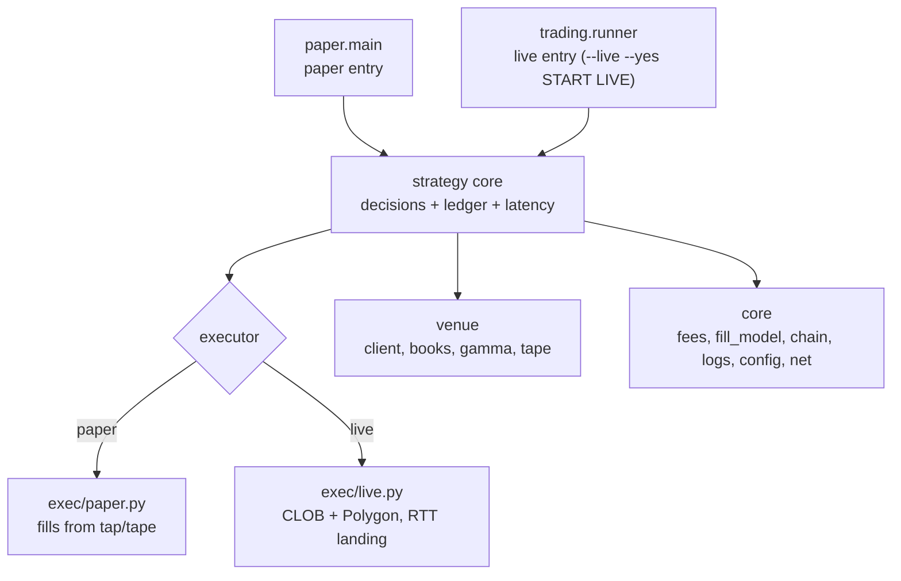

# Legacy cleanup and convergence report

Evidence date: 2026-11-10. Reachability was computed with an AST import BFS from
the two real entry points, not from filenames. Line counts are **code lines**
(non-blank, non-comment).

## 0. Target architecture

Two entry points, one strategy core. Anything not reachable from these two is
deleted, not "kept for later".



The property that matters: **the same decision functions must produce the same
order intent in both entries.** Today they do not — the live path has its own
decision code inside `trading/engine.py` (2,869 code lines) and does not use the
settlement allocator or the paper CTF gate at all. That divergence is the root
problem; the dead files are a symptom of it.

## 1. Measured current state

| Metric | Value |
|---|---|
| Modules under `src/polymarketbot/` | **198** |
| `src/` code lines | **70,592** |
| `tests/` | 105 files / **28,279** code lines |
| Reachable from paper entry | 76 modules / 25,319 |
| Reachable from live entry | 53 modules / 25,068 |
| Reachable from both | **29 modules / 11,919** |
| Reachable from neither | **98 modules / 32,124 (45.5 %)** |
| Files > 300 code lines | **77 files / 53,884 (76 % of `src/`)** |

Entry points, with evidence:

- **paper** = `polymarketbot.paper.main` — `main():112`, `DEFAULT_DB
  data/paper_engine.db:24`, and the live `ExecStart` in
  `deploy/polymarketbot.service:28` (`--capital 3000`).
- **live** = `polymarketbot.trading.runner` — `main():2193`,
  `require_live_confirmation():286` with `LIVE_CONFIRMATION_PHRASE`
  `runner.py:84` (`--live` + `--yes` + typed `START LIVE`; anything else exits
  2), DB `data/real_money_trading.db:255`, ledger `:261`, builds
  `RealMoneyTradingEngine` (`runner.py:73`) with `LiveClobClient`
  (`client.py:592`) and `PolygonCtfClient`. It is the commented override at
  `deploy/polymarketbot.service:34`. No other module has a `__main__` that
  places orders or signs transactions (`trading/engine.py` has none).

### 1.1 The blocker that must be fixed first

`from pkg.sub import x` executes the parent `__init__`. Because
`paper/engine.py:31` does `from polymarketbot.trading.domain2 import
settlement_allocator`, **the paper trader loads the entire live stack at
startup** through `trading/__init__.py:12-127` (engine, client, negrisk,
binance_*, latency_sniper, ctf_allocator…) and `domain2/__init__.py:17-63`
(harvester, placer, worker).

A symbol grep of `paper/` returns **zero** references to `harvester_engine`,
`settlement_worker`, `clob_order_placer`, `maker_pricing_engine`,
`event_listener`, `gamma_universe`, `ortools_allocator`, `dynamic_sizer`,
`circuit_breaker`, `knobs`. They are imported for no reason other than the
barrel. Every deletion below is unsafe until the barrels are emptied, because a
deleted module will still be imported by `paper.main`.

**Measured, not inferred:** `import polymarketbot.paper.main` loads **102**
`polymarketbot` modules, of which **12 are live-stack modules the paper trader
never calls**:

```
trading.engine                 trading.negrisk_engine
trading.latency_sniper         trading.binance_anchor
trading.binance_quant_engine   domain2.harvester_engine
domain2.settlement_worker      domain2.clob_order_placer
domain2.maker_pricing_engine   domain2.ortools_allocator
domain2.dynamic_sizer          domain2.circuit_breaker
```

`trading.engine` alone is 2,869 code lines. This is the single largest reason the
"one paper entry" is not actually isolated today.

## 2. Duplicate families — keepers and reasons

| Family | Members (anchor) | Keep | Why |
|---|---|---|---|
| Engines | `trading/engine.py:336` (2,869), `paper/engine.py:45` (284), `simulator/engine.py:169` (1,876) | `trading.engine` (live: `runner.py:73`) + `paper.engine` (paper: `main.py:19`) | `simulator.engine` is reachable only from `simulator/__init__.py:41` and 7 tests; its lines 413-1313 duplicate `trading/base.py`. **Delete, do not split.** |
| Venue/client | `trading/client.py:592`, `dataapi.py:48`, `paper/venue.py:52`, `simulator/feed.py:413`, `data/streams/clob.py:158` | `trading.client` + `dataapi` (live), `paper.venue` (paper), `feed.py` (live WS) | `data/streams/*` are test-only. |
| Reward sizing | `rewards/scanner/*`, `rewards/allocator.py`, `scoring.py`, `queue_valuation.py`, `liquidity_router.py:804`, `complement_quoter.py:858`, `as_inventory_engine.py:748`, `binance_anchor.py:633`, `binance_quant_engine.py:872`, `latency_sniper.py:503` | `scanner/*` (live) + `allocator`/`scoring`/`queue_valuation` (both entries) | The rest are barrel/test-only and refuted by measured data (see profitability report §5). |
| Settlement | `trading/settlement.py:774`, `paper/pillars/settlement.py:29`, `domain2/settlement_fair_value.py:931`, `settlement_allocator/*` | `trading.settlement` as the live **execution route**; `settlement_fair_value` + `allocator` as the one **sizing** logic | **Live currently has no sizing logic at all** — this is the main convergence gap, not a duplicate to delete. |
| CTF | `trading/ctf.py:608`, `ctf_allocator.py:726`, `ctf_split_arbitrage.py:114` | `trading.ctf` | `ctf_allocator` → `ctf_split_arbitrage` only; both dead. |
| Fee schedule | `fees.py:116` plus copies in `negrisk_engine:192`, `latency_sniper:62`, `binance_anchor:650`, `binance_quant:1025`, `maker_pricing:230`, `domain2_kelly:106`, `simulator/engine:1337` | `fees.py` | Seven divergent copies of a protocol constant is a correctness hazard, not just clutter. |
| Fill probability | `paper/pillars/ctf/parity.py:135`, `rewards/queue_valuation.py:241`, `maker_pricing_engine` copy | both (different objects: quote-fill vs queue-fill) | Delete the `maker_pricing_engine` drift copy. |

## 3. Deletion plan — dependency-safe waves

Each wave ends with a gate; do not start the next wave until the gate is green.
Waves 1-2 are mechanical and low risk. Waves 3-5 remove ~30k code lines and
roughly half the test suite; that is the point.

### Wave 1 — empty the barrels (must be first)

- Rewrite `trading/__init__.py` (174 lines) and `trading/domain2/__init__.py:17-63`
  down to docstrings; delete the alias block `trading/__init__.py:206-215`.
- Fix the four import sites this unblocks: `paper/engine.py:31,32`,
  `paper/pillars/tail_budget.py:20,24`.
- **Gate:** `paper.main` imports; full suite green; a 60 s `paper.main` smoke.
- Effect: paper stops loading the live stack. No deletions yet, but waves 2-4
  become possible.

### Wave 2 — delete barrel-only strategy engines

`as_inventory_engine`, `binance_anchor`, `binance_quant_engine`,
`latency_sniper`, `negrisk_engine`, `complement_quoter`, `ctf_allocator` →
`ctf_split_arbitrage`, `liquidity_router`, `domain2/{harvester_engine,
maker_pricing_engine, clob_order_placer, settlement_worker, event_listener,
gamma_universe, circuit_breaker, ortools_allocator, dynamic_sizer, knobs}`,
`proxy_wallet`, `relayer`, `safe`, `domain2_kelly`, `rewards/merger`.

Every one of these is either refuted by measured data (table above,
profitability report §5) or has zero symbol use in `paper/`.

- Delete with them: `test_as_inventory_engine`, `test_binance_anchor`,
  `test_binance_quant_engine`, `test_complement_quoter`,
  `test_ctf_marginal_allocator`, `test_ctf_split_arbitrage`,
  `test_latency_sniper`, `test_negrisk_engine`, `test_domain_fee_audit`,
  `test_domain2*`, `test_wallet_auth`, `test_quote_lifecycle`, and the
  `test_idea_*` family (13 files).
- **Gate:** suite green; `grep -rn "import.*negrisk_engine\|import.*latency_sniper" src/ tests/` empty.

**Decision required before this wave:** `ctf_allocator` and `negrisk_engine`
have research value (they encode protocol mechanics). If that is to be retained,
move the ~200-line fee/coherence primitives into `strategy/ctf/` and delete the
rest — do not keep the file.

### Wave 3 — delete the simulator and the data-collection platform

- `simulator/` except `feed.py` and `optimizer.py`; move those to
  `trading/feed.py` and `strategy/sizing.py`, update `runner.py:64,68`.
  Delete `simulator.engine` outright (it duplicates `trading/base.py`).
- `data/builders/` (13 builders, ~1,700 lines), `data/streams/{clob,binance,
  deribit,kalshi,kalshi_books,news,whales,health}`, `data/{collector,universe,
  writer,l3,l3_queue,labels_api,live_rewards,kalshi_mapping,kalshi_backfill,
  gamma_snapshot,tape_validation,uma_replay,refresh_universe_metadata,config,
  context,schema}`, `netclock`, `kalshi_auth`, `kalshi_candles`, `wallets`,
  `universe/`.
- **Precondition:** move `parse_log` from `data/streams/polygon.py` into
  `data/uma.py`; the only paper uses are `paper/uma_poll.py:437-438`. Keep
  `data/uma.py`.
- **Tests to delete:** stream/universe/writer/l3/kalshi/tape/uma_replay/
  validate_tape/wallets/categories plus three universe-metadata tests.
- Note: this deletes `data/kalshi_mapping.py` (2,134 code lines) and the Kalshi
  recorder. The Kalshi print-lead signal is the one *measured* outside-pillar
  edge (0.696 agreement @1 s, n=1,143). **Keep the recorder only if it is wired
  into the reward pillar as a cancel trigger in the same wave** — otherwise the
  signal has no consumer and the recorder is dead weight by definition.

### Wave 4 — delete the remaining unowned packages

`ops/*`, `reports/*`, `tools/*` (9 files, 3,787 lines; `tools/preflight.py:90`
duplicates `engine.preflight_check():572`), `ui/app.py`, `strategy/*`,
`storage.py`, `db.py`.
Keep `tools/fill_calibration` and `tools/market_scorecard` **only** if their
calibration output is consumed by `fill_model`; otherwise delete both.
- **Tests:** `test_ui`, `test_storage`, `test_market_scorecard`,
  `test_builtin_strategy`, `test_composite_strategy`, `test_orchestrator`,
  `test_fill_model` (rewrite against `polymarketbot.fill_model` directly).

### Wave 5 — delete one-off scripts and the paper session recorder

- `scripts/ctf_complete_set_census.py` (805), `scripts/reward_window_census.py`
  (417), `scripts/settlement_tail_budget_check.py` (249): all measurement-only,
  zero importers. Their findings are in `docs/profitability-report.md`; the
  artifacts stay in `data/derived/`.
- `trading/session_recorder.py:891-1050` (`PaperSessionRecorder`) — recipient
  of `test_paper_session_recorder`; live keeps `LiveSessionRecorder:127`.

### Must survive all waves

`fees.py`, `fill_model.py`, `chain.py`, `net.py`, `gamma.py`, `logs.py`,
`config.py`, `dataapi.py`, `risk/fast_signer.py`, `execution/*`,
`trading/{client,ctf,settlement,pending_settlements}`, `data/uma.py`,
`paper/*`, `rewards/{allocator,scoring,queue_valuation}`, and the whole
`strategy/` core.

## 4. Convergence — how the two entries share one strategy core

This is the part that is not deletion. Current state after waves 1-5: ~38k code
lines in `src/`, two entries, but the live entry still decides for itself.

### 4.1 Move the decision code out of both entries

| Move | From | To |
|---|---|---|
| Reward decision | `paper/pillars/reward.py` (799) | `strategy/reward/decision.py` |
| Reward sizing | `rewards/allocator.py` (871), `scoring.py` (218), `queue_valuation.py` (546) | `strategy/reward/` |
| Switch policy | `rewards/switching.py` (450) | `strategy/reward/switching.py` |
| Settlement decision | `paper/pillars/settlement.py` (424) | `strategy/settlement/decision.py` |
| Settlement sizing | `domain2/settlement_fair_value.py` (931), `settlement_allocator/*` (~1,566) | `strategy/settlement/` |
| CTF gate | `paper/pillars/ctf/*` (~1,037) | `strategy/ctf/` |
| Accounting | `paper/ledger.py` (360) | `strategy/ledger.py` |
| Landing clock | `paper/latency.py` (139) | `strategy/latency.py` |
| Live decisions | `trading/engine.py` quoting 1222-1510, CTF merge 1857-2265 | call `strategy/*`, delete the inline copy |

Everything moved is already free of I/O except through injected collaborators
(`venue`, `ledger`, `executor`), which is why the move is mechanical.

### 4.2 One executor interface

```python
class Executor(Protocol):
    def submit(self, intent: OrderIntent) -> PendingAction: ...
    def cancel(self, action: PendingAction) -> PendingAction: ...
    def land_after(self, action: PendingAction, rtt_s: float) -> Landed: ...
```

`exec/paper.py` fills from the book/tape; `exec/live.py` posts to the CLOB and
waits the measured RTT. Both consume the same `OrderIntent` produced by
`strategy/*`. The latency contract ("every action that changes state pays one
measured round trip") lives in the executor, once, instead of in both engines.

### 4.3 The convergence test that proves it

A single test that, given one recorded book snapshot, asserts the paper and live
decision paths emit **identical order intents**. Without it, "shared strategy
code" is an aspiration; with it, divergence fails CI. This is the one new test
worth adding in this whole refactor.

### 4.4 Closing the live gap

Live currently has no settlement sizing: `settlement_allocator` is paper-only.
Until `exec/live.py` calls `strategy/settlement/allocator`, the live trader is
running a *different strategy* from the one being audited. That is the highest
correctness risk in the tree and should be done in the same wave as 4.1, not
after it.

## 5. Large-file splits — after deletion, not before

Deleting waves 2-4 removes roughly half of the 77 files over 300 code lines.
Split only what survives.

| File | Code lines | Proposed seams |
|---|---|---|
| `trading/engine.py` | 2,869 | `MarkoutTracker:151`; preflight/reconcile `87,572,735,988,1807`; quoting `1222-1510`; CTF merge `1857-2265` → four modules, most of which becomes `strategy/` after §4 |
| `trading/client.py` | 2,166 | auth `368,516`; tick/rounding `245,253`; build/sign `1114,1281,1378`; dispatch `1438,1539,1735`; read API `1989-2156` |
| `trading/runner.py` | 1,963 | CLI `105,286`; resolve `592`; dashboard `900-1184`; switching `441,470`; loop `1634-2193` |
| `trading/base.py` | 1,440 | `MarketEconomics:80`; SQLite schema `335-708`; quote loop `903-1429`; yield/switch `1565-1693` |
| `trading/ctf.py` | 1,436 | RLP/EIP-1559 `243-390`; gas `415-608`; calldata `711,758,1419`; client/settlement `608-1545` |
| `trading/session_recorder.py` | 962 | keep `LiveSessionRecorder:127` only (wave 5 deletes the rest) |
| `data/universe.py` | 1,168 | delete (wave 3) |
| `trading/negrisk_engine.py` | 1,596 | delete (wave 2) |
| `simulator/engine.py` | 1,876 | delete, never split (wave 3) |

Rule for the survivors: a module is split when it has more than one reason to
change, not when it crosses 300 lines. The four already done today
(`paper/engine.py` 1,168→288, `paper/pillars/ctf.py` 1,140→package,
`rewards/scanner.py` 1,520→package, `settlement_allocator.py` 1,578→package)
were split because their seams were already visible in the method list.

## 6. Gate for every wave

1. `uv run python -c "import polymarketbot.paper.main"` and
   `"import polymarketbot.trading.runner"` both clean.
2. `uv run python -m pytest -q tests/` green. Current baseline: **1,726 passed,
   1 skipped, 150 s**. The suite will shrink with the deletions; record the new
   baseline in the commit message so a later regression is visible.
3. A 60 s `paper.main --duration 60` smoke that writes at least one snapshot row
   per pillar. Deleting a module that a pillar silently imported must fail here,
   not in the 30-minute soak.
4. `grep -rn "import polymarketbot" src/ | wc -l` before and after, and the
   reachability BFS re-run: the "neither" set must shrink, never grow.

## 7. Risks and sequencing constraints

- **Wave 1 first, always.** Deleting before emptying the barrels produces
  `ImportError` in the paper entry from a module nothing references.
- **`paper/window` and `settlement_allocator` are both mid-fix.** The settlement
  cadence fix (profitability report §2.4, §7.2) touches
  `paper/pillars/settlement_runner.py` and the radar; land it before moving
  those files in §4, or the move will conflict.
- **The 30-minute audit loop is suspended during waves 2-4.** The soak cannot run
  while the tree is mid-deletion; use the 60 s smoke as the gate.
- **Do not delete on the strength of "no test imports it".** 34 test files
  currently import only dead modules; they will be deleted with their subjects,
  so the test count dropping is expected, not a regression.
- **`data/raw` is immutable** — no wave touches it.
