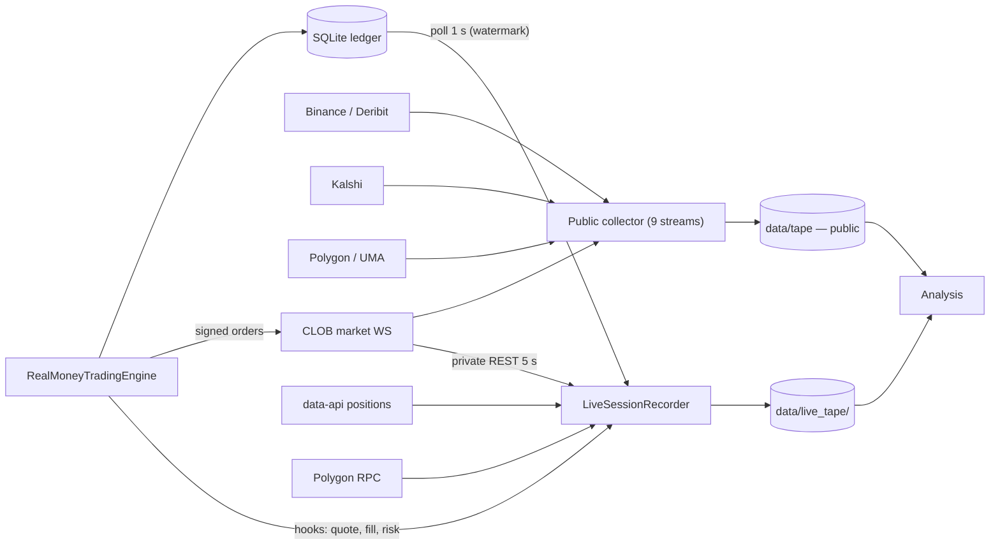

# Live-trading data architecture

How data collection runs while real money is trading, and what the real-money
trader records that the public collector cannot. Companion to
`docs/tape-initial-analysis.md` and `docs/live-data-gap-analysis.md`.

**Status 2026-11-05 (v2):** implemented in
`src/polymarketbot/trading/session_recorder.py` and wired into
`polymarketbot.trading.runner` via `--record-live-data`
(`--no-record-live-data` disables; default on for live, off for dry-run).
The engine emits quote/risk events through a no-op-by-default
`event_hook`. v2 adds the authenticated CLOB user WebSocket
(`wss://ws-subscriptions-clob.polymarket.com/ws/user`, `PING`/`PONG`,
reconnect with backoff), on-chain POL/USDC.e/CTF balances every 30 s,
settlement receipts for `pending_settlements` hashes, per-order
`get_order_scoring` every 15 s, and REST/engine place-cancel latency rows.
A dry-run smoke (8 s) recorded 144 rows across `active_quotes`,
`portfolio_snapshots`, `positions`, `deskew_events`, `reward_epochs`,
`quotes`, `orders`, `account`, `rewards`, `chain_account`, `latency` and
`session_health`, with 0 dropped and 0 errors. The user WebSocket is
exercised end-to-end in `tests/test_session_recorder.py` against a local
server (auth frame, order/trade row). `PaperSessionRecorder` writes a
`mode="paper"` session with the same columns from the paper engine.
The public collector was not modified.

## 1. Current architecture

| Process | What it does | Writes | Runs during live? |
|---|---|---|---|
| Public collector (`python -m polymarketbot.data.collector`) | 9 streams: CLOB books/trades, Binance, Deribit, Polygon, UMA, news, whales, Kalshi, universe | `data/tape/` (5.5–5.8 GB/day) | yes, separate process |
| Live runner (`polymarketbot.trading.runner`) | one `RealMoneyTradingEngine` for one condition; `LivePolymarketFeed`; `LiveClobClient` REST; risk; merges | `data/real_money_trading.db` (SQLite), `real_money_trading_ledger.json`, logs | yes |
| Paper runner | `PaperTradingEngine`, multi-market, simulated fills/queue | paper ledger JSON, logs | separate |
| Monitor / watchdog | collector health; restart if dead | `data/logs/collector_alerts.log`, watchdog log | yes |

What is **not** recorded today:

* our order/fill/cancel lifecycle as a table (SQLite has some of it; no tape),
* account snapshots (CLOB balance/allowances, data-api positions, on-chain
  USDC.e/CTF, pending settlements),
* actual reward accrual/epoch payouts (only modelled),
* quote intent vs venue acknowledgement, cancel latency, queue position,
* risk decisions and event-cap blocks,
* gas/tx receipts for merges/redemptions.

The public collector's CLOB data is anonymous. The live session therefore
needs its own recorder; the public tape supplies the market context.

## 2. Design: LiveSessionRecorder

Run it **in-process with the live runner**, as two daemon threads (poller and
writer) plus a bounded queue. In-process is chosen because it shares the
`LiveClobClient` credentials and the engine's SQLite, has no cross-process
locking, and the recorder's lifecycle is the session's. The cost is that a
trader crash ends recording; the venue/user REST can be polled again after a
restart with a new session id. A sidecar process is the fallback if the trading
process must be isolated; the schema and session manifest stay the same.



### 2.1 Session lifecycle

1. Runner reconciles startup, then calls `recorder.start(...)`.
2. Recorder writes `session.json` (below) and starts poller/writer.
3. First poll captures the initial state before the first quote; the runner
   waits for `initial_snapshot_done` (bounded, e.g. 10 s) before entering the
   quote loop. This is the only blocking interaction.
4. On SIGINT / normal exit, `recorder.stop()` drains the queue, flushes the
   last Parquet parts, closes the journal, and writes `session.end`.
5. A crash leaves the JSONL journal and partial Parquet parts; the journal is
   replayable into the last complete part.

### 2.2 Session manifest

`data/live_tape/<session_id>/session.json`:

```json
{
  "session_id": "20261105T134500Z-a1b2c3",
  "started_at": "2026-11-05T19:15:00+05:30",
  "host": "DESKTOP-...", "pid": 1234,
  "git_commit": "...", "config_hash": "sha256:...",
  "dry_run": false, "wallet": "0x...", "api_key_id": "first8...",
  "condition_id": "0x...", "event_id": "30829", "tokens": ["yes","no"],
  "fee_type": "politics_fees", "tick_size": 0.01,
  "neg_risk": true, "rewards_min_size": 200, "rewards_max_spread": 5.5,
  "daily_reward_rate": 400.0,
  "engine": {"quote_size": 20, "spread_offset_cents": 0.5,
             "bankroll_usd": 300, "institutional_mode": true},
  "public_tape_run": "20261105T124829",
  "end": {"stopped_at": "...", "reason": "sigint"}
}
```

No secret is serialized: no private key, no API secret/passphrase; only the
wallet address and the first 8 characters of the API key id.

### 2.3 Tables

All tables carry `session_id`, `recv_ts_ns`, `recv_mono_ns`, `source`
(`engine|venue|data-api|chain`). Parquet, one part per 10 minutes per table,
ZSTD, inside `data/live_tape/<session_id>/<table>/date=/hour=/`.

| Table | Cadence | Rows | Fields (abridged) |
|---|---|---|---|
| `quotes` | 1 s state diff + event hook | one per quote state change | `token_id`, side, price, size, status, quote_id, risk_decision, reason |
| `orders` | 5 s venue REST + engine hook | one per order update | order_id, asset, side, price, size, status, ack_latency_ms, cancel_latency_ms |
| `fills` | 5 s venue REST + SQLite poll | one per fill | trade_id, order_id, asset, side, price, size, fee_usd, tx_hash, fill_ts |
| `positions` | 15 s | one per token | shares, avg_cost, market_value, unrealized/realized, source |
| `account` | 15 s | one per snapshot | usdc_balance, allowance, pol_balance, open_orders, pending_settlements |
| `rewards` | 60 s | one per epoch/campaign | epoch, score, payout, campaign, pool, competitor_estimate |
| `risk_events` | event hook | one per block/breaker | kind, reason, asset, size_requested, size_approved, event_exposure_usd |
| `chain_tx` | on event + 15 s | one per tx | kind (merge/redeem/split), tx_hash, gas, status, block |
| `latency` | 1 s | one per probe | place_rtt_ms, cancel_rtt_ms, feed_age_ms, user_rest_age_ms |
| `session_health` | 10 s | one per snapshot | queue_depth, dropped_snapshots, last_poll_age, errors, recorder_lag_ms |

`fills` and `orders` are the ground truth for the fill model. `quotes` records
intent; the venue `orders` table records acknowledgement. Comparing the two
gives cancel effectiveness and queue position.

### 2.4 Inputs and polling

| Source | API | Cadence | Why |
|---|---|---|---|
| Engine SQLite | `fills`, `rebalances`, `reward_payouts`, `portfolio_snapshots`, `active_quotes`, `deskew_events` | 1 s, read-only WAL, ts watermark | order/fill/merge events even if REST fails |
| CLOB private | `GET /data/orders?market=`, `/data/trades?maker_address=`, `/balance-allowance`, `/rewards` | 5 s orders/fills, 15 s balances, 60 s rewards | venue truth |
| CLOB user WS | `wss://ws-subscriptions-clob.polymarket.com/ws/user` (`type=user`, API credentials, condition filter) | event; `PING` 10 s; reconnect 2–30 s backoff | sub-second order/fill/cancel events |
| Order scoring | `GET /order-scoring?order_id=` per resting order | 15 s | queue/reward qualification |
| Data API | `GET https://data-api.polymarket.com/positions?user=<wallet>` | 15 s | cross-check positions |
| Polygon | existing `ctf_client` / `chain.py` RPC | 30 s balances/allowances; on-event receipts | settlement truth |
| Engine hooks | `record_event(kind, payload)` no-op default | event | risk blocks, quote intent, merge state |
| Public tape | `data/tape` (already running) | n/a | the book context at quote time |

The CLOB user WebSocket is enabled for live sessions (disabled for dry-run)
and runs in its own thread: it sends the `type=user` subscription with the
L2 credentials and the session's condition, maps `order`/`trade` frames to
`user_orders`/`user_fills` (unknown types to `user_events`), heartbeat
`PING` every 10 s, and reconnects with 2–30 s backoff. The 5 s REST
reconciliation continues in parallel; a missing WS only lowers event
resolution, never the recorded venue state.

### 2.5 Backpressure and failure isolation

* One bounded `queue.Queue(maxsize=10_000)`.
* Order/fill/risk rows are **never dropped**: the poller reads them from SQLite
  by watermark, so a full queue pauses the poller (not the trader) and resumes.
* Snapshot rows may be dropped; `session_health.dropped_snapshots` increments;
  the next snapshot is fresh.
* The writer batches 1–2 s, writes a part, fsyncs, updates the journal. Any
  exception is caught per thread; the recorder marks itself degraded and
  continues; the trading loop never awaits it.
* The recorder's queue depth and age are exported to `session_health` and the
  existing monitor. A stalled recorder is a WARN, not a kill.
* The recorder uses the runner's `LiveClobClient` (thread-local HTTP sessions,
  read-only calls) so it adds no second credential refresh or signing path and
  never calls `place_order`/`cancel_order`.

### 2.6 Storage, CPU and runbook

* ~10–50 MB/day: orders/fills are small; 15 s position/account snapshots
  dominate. 14 sessions < 1 GB. Separate from the public tape, so the public
  writer is never shared across processes.
* CPU: two threads, REST at 0.3–1 req/s, writer every 1–2 s; negligible next to
  the collector. Do not run the heavy analysis jobs (DuckDB rebuilds) while the
  live trader is quoting; the one-CPU rule still applies to compute jobs.
* Start: `run_real_money_trader.py` gains `--record-live-data` (default on for
  live, optional for dry-run). The runner logs the session path at start and
  the row counts at stop. The public collector continues independently.
* Stop: normal exit drains; a crash leaves `journal.jsonl`; a small
  `scripts/replay_live_journal.py` can turn it into Parquet.

## 3. Scrapers exclusive to the real-money trader

Priority for the first live session:

**P0 (must have) — implemented v2**
1. CLOB private orders and user trades (REST 5 s + user WS).
2. Account snapshots: CLOB balance/allowance, data-api positions, on-chain
   USDC.e/POL/CTF balances.
3. Engine fills/rebalances/merges (SQLite watermark).
4. Quote intent + risk decisions (engine hook).
5. Session manifest and health.

**P1 (first week) — implemented v2**
6. Reward accrual/epoch payouts (`/rewards`, `get_daily_rewards`).
7. Gas/tx receipts for `pending_settlements`; pending settlements.
8. Latency probes: place/cancel RTT, feed staleness, REST latency.
9. Market metadata snapshot for the session's market (fee, tick, negRisk,
   reward config) from `universe_metadata` / manifest.

**P2 (pilot hardening)**
10. CLOB user WebSocket for sub-second order/fill events — implemented v2.
11. `get_order_scoring` per open order (queue score) — implemented v2.
12. Kalshi/CLOB cross-check for the traded market (already in the public tape).
13. Session-to-public-tape exact join test (condition/asset/ns skew) —
   done: `scripts/analyze_live_session_join.py`, reports in
   `docs/live-session-join-report*.md`. The dry-run found a stale
   `--token-no` flag (Gamma vs CLOB NO asset); the runner now refuses any
   flag that disagrees with the CLOB market detail.

Paper-vs-live parity on the same columns (`PaperSessionRecorder`) is wired.

## 4. What changes in the current trading architecture

1. **Recorder (new).** In-process, P0 tables, session manifest; no change to the
   quote path except the non-blocking `record_event` hook and the session id.
2. **Event-level caps (done).** `RiskConfig.max_event_*`, wired through the
   paper, rewards and live engines; `MarketConfig.event_id` is carried by the
   scanner and the live runner.
3. **Paper trader parity (done).** `PaperSessionRecorder` writes the paper
   engine's positions/fills/virtual quotes/epoch snapshots and portfolio
   summary with the live recorder's columns, under `data/live_tape/paper-*`
   with `mode="paper"`. `scripts/run_paper_trading.py` starts/stops it around
   the paper run. Paper-vs-live comparisons can now use the same columns.
4. **Live single-market limitation.** The live engine is one condition per
   process; the event cap is enforced within that market. If the runner later
   quotes several markets in one event, the per-event aggregate needs a shared
   position ledger (the paper engine already has one; the live runner does
   not). Do not add multi-market live quoting until that ledger exists.
5. **No strategy change from 31 h.** The data shows 834 traded conditions, 3 c
   median spread, -0.5 c median markout and 28 conditions with ≥30 markouts.
   That is enough to justify a *recorded pilot*, not a parameter change. The
   first live session should run the current parameters and record; the 14-day
   tape and the session data decide the next change.
6. **Data hygiene.** Keep the public collector running; filter Kalshi reports to
   the 233-ticker mapping; filter current-universe reports to the manifest.

## 5. Open decisions

* In-process recorder vs sidecar: recommended in-process for the pilot; a
  sidecar only if the trader process is going to be isolated or restarted
  independently.
* User WS vs REST-only: REST-only for day 1; measure the 5 s gap against the
  venue's order acks; add the WS if the gap matters.
* Positions truth: data-api and chain disagree occasionally; record all three
  (engine, data-api, chain) with `source` and reconcile in analysis.
* Retention: keep every live session indefinitely (small); the public tape is
  the large dataset.
