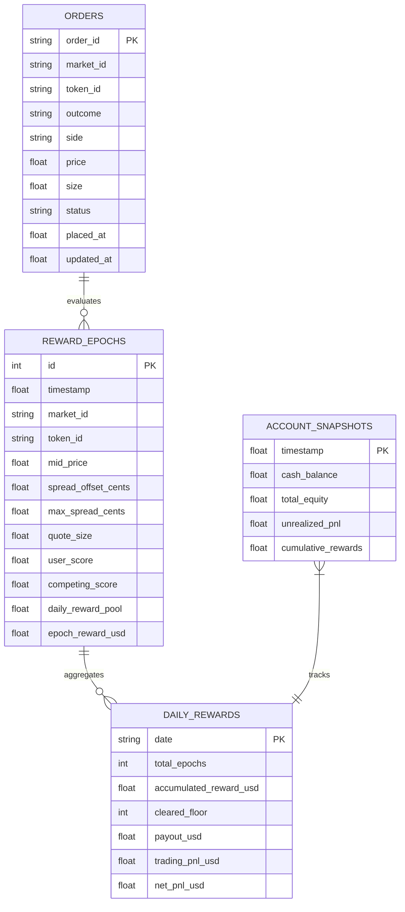

# PolySimulator Cloud Paper Trading & Rewards Architecture

This document details the architecture, microstructure design, and execution runbook for running our Polymarket Liquidity Rewards bot on **PolySimulator** (`api.polysimulator.com`) over the next 1-month forward testing window, prior to deploying real capital on Polygon mainnet.

---

## 1. PolySimulator Platform Evaluation: Strengths vs. Honest Gaps

Following forensic inspection of the official documentation corpus (`C:\Users\Sivasai\Desktop\poly-sim.txt`), here is the objective assessment of PolySimulator:

### Strengths (Why We Keep PolySimulator)
1. **Live Polymarket CLOB Depth & Matching:** PolySimulator connects directly to Polymarket's live CLOB and Gamma feeds via Redis, matching virtual orders against actual market depth, book walking, and live trades every ~1 second.
2. **Realistic Fee Schedule:** Implements Polymarket's exact V2 per-category taker fee schedule (Crypto 7%, Economics/Tech/Culture 4%–5%, Sports 3%, Geopolitics 0%) with 0% maker fees for resting orders.
3. **Slippage & Collateral Modeling:** Honors tick sizes (0.01, 0.001), slippage bounds, and maintains an isolated simulated **$100.00 USD API wallet** for our free-tier API key (`ps_live_75cae7...`), matching our micro-capital target.
4. **Clean REST/WebSocket API:** Fast order submission (`POST /v1/clob/order`), order lifecycle tracking (`GET /v1/orders`), and explicit cancel confirmations (`POST /v1/cancel-all?confirm=true`).

### Honest Gap: Polymarket Quadratic Rewards Engine
As documented explicitly in `poly-sim.txt` (lines 3173–3176 & 3325–3331):
> *"Rewards / builder / RFQ are honest stubs. The rewards/scoring reads return honest empties (`get_order_scoring` -> `False`, the `list_*` rewards reads -> empty paginators, `get_reward_percentages` -> `{}`). The paper rewards engine is a separate roadmap item, so a reward-accounting loop runs and truthfully finds nothing (rewards aren't earned on paper)."*

### Strategic Decision: Option 2 (Keep PolySimulator + Local SQLite Rewards)
- **Option 1 (Discard PolySimulator):** Losing PolySimulator forces us back into pure local in-memory simulation without cloud-hosted state, remote order persistence, or external matching engine validation.
- **Option 2 (Selected): Keep PolySimulator for execution + SQLite for rewards.** PolySimulator handles realistic CLOB fills, slippage, order states, and account balance. Our local SQLite database (`data/polysim_paper_trading.db`) samples resting quotes against live book depth every 60 seconds, computes the exact quadratic reward formula $S(v, s) = ((v - s)/v)^2 \times \text{size}$, and tracks daily payouts with the $1.00 payout floor.
- **Verdict:** Option 2 gives the highest fidelity forward test possible without risking real capital.

---

## 2. Microstructure: Binary Complementation Quoting

In prediction markets, attempting to place a `SELL YES` limit order without owning YES tokens fails with:
```
400 Bad Request: "Insufficient position for limit sell order"
```
Prediction markets do not allow naked short selling of outcome tokens. However, prediction market contracts are binary complements:
$$\text{Price}(\text{YES}) + \text{Price}(\text{NO}) = \$1.00$$

Selling YES at price $P_{\text{ask}}$ is economically and mathematically identical to **buying NO** at:
$$P_{\text{bid}}(\text{NO}) = 1.00 - P_{\text{ask}}(\text{YES}) = (1.00 - P_{\text{mid}}) - \text{half\_spread}$$

### Two-Sided Maker Quoting Architecture
To quote both sides of the book without pre-existing token inventory:
1. **Bid Side:** Submit `BUY YES` at $P_{\text{bid}}(\text{YES}) = P_{\text{mid}} - \text{half\_spread}$.
2. **Ask Side:** Submit `BUY NO` at $P_{\text{bid}}(\text{NO}) = (1.00 - P_{\text{mid}}) - \text{half\_spread}$.

Both legs are cash-collateralized `BUY` limit orders. If both sides fill:
- E.g. 50 shares of YES @ $0.31 ($15.50 spent) + 50 shares of NO @ $0.68 ($34.00 spent) = $49.50 total cost.
- Complete set redemption value = $50.00 ($1.00 per pair).
- Net locked spread = +$0.50 (+1.0¢/share), zero directional risk, and qualifying quadratic rewards earned on both sides.

---

## 3. Local SQLite Architecture (`data/polysim_paper_trading.db`)

All order states and reward calculations are recorded in `data/polysim_paper_trading.db` via `PolySimDatabase`:



### Reward Formula & Floor Enforcement
- **Epoch Sampling:** Evaluated every 60 seconds (1,440 epochs/day).
- **Quadratic Score:** $S(v, s) = \left(\frac{v - s}{v}\right)^2 \times \text{size}$, where $v = 3.0\text{¢}$ max qualifying spread and $s = 0.75\text{¢}$ spread offset.
- **Payout Floor:** If `accumulated_reward_usd` $< \$1.00$ at day close, actual payout is $\$0.00$. Once $\ge \$1.00$, the full accrued reward is credited.

---

## 4. Execution Runbook

### Key Commands

```powershell
# 1. Dry-run preflight (verifies $100 balance, API key auth, and market book):
uv run python scripts/run_polysim_paper_trader.py --dry-run

# 2. Run forward paper trading for 1 hour (3600 seconds) with 50-share quotes:
uv run python scripts/run_polysim_paper_trader.py --duration 3600 --quote-size 50 --spread-offset 0.75

# 3. Target a specific market keyword:
uv run python scripts/run_polysim_paper_trader.py --duration 1800 --filter "Netanyahu"

# 4. Emergency Kill-Switch (cancels all resting orders on PolySimulator):
uv run python scripts/run_polysim_paper_trader.py --cancel-all
```

### Rate Limiting & Safety Guardrails
- **Free-Tier Limits:** 2 req/sec burst / 120 req/min sustained. Built-in 0.6s inter-order delay and exponential backoff on HTTP 429.
- **Heartbeat & Dead-Man's-Switch:** Every exit signal (Ctrl+C, timeout, unhandled error) calls `cancel_all_quotes()` and `POST /v1/cancel-all?confirm=true` to guarantee zero dangling orders.

### Inspecting Results
Query live database progress using DuckDB or SQLite:
```powershell
uv run python -c "import sqlite3; conn = sqlite3.connect('data/polysim_paper_trading.db'); conn.row_factory = sqlite3.Row; print('Orders:'); [print(dict(r)) for r in conn.execute('SELECT * FROM orders').fetchall()]; print('Daily:'); [print(dict(r)) for r in conn.execute('SELECT * FROM daily_rewards').fetchall()]"
```
