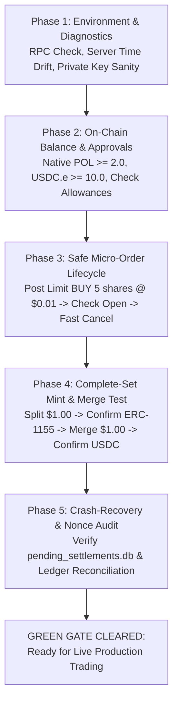

# Polymarket Smart Contract Verification & EIP-712 Order Signing Guide

This guide establishes the technical specifications, on-chain contract interfaces, cryptographic signing schemas, gas/mempool dynamics, and step-by-step preflight verification runbook required before deploying real capital on **December 1st**.

---

## 1. Executive Summary & Critical Context

Polymarket operates a hybrid decentralized architecture:
1. **Off-Chain Central Limit Order Book (CLOB):** Matching engine hosted at `https://clob.polymarket.com`. Orders are EIP-712 structured data payloads signed off-chain by users and matched by an operator relayer.
2. **On-Chain Settlement Layer (Polygon PoS - Chain ID 137):** Settlement and asset custody occur on Polygon Mainnet via the **Conditional Tokens Framework (CTF)** and Polymarket's **CTF Exchange V2** smart contracts.

> [!IMPORTANT]
> **V1 Protocol Deprecation:** The legacy CTF Exchange V1 contracts (`0x4bFb41d5B3570DeFd03C39a9A4D8dE6Bd8B8982E` and `0xC5d563a36AE78145C45a50134d48A1215220f80a`) were retired on April 28, 2026. The live production venue runs exclusively on **CTF Exchange V2**. Any order signed with V1 schemas or submitted to V1 addresses is invalid and rejected.

---

## 2. Core Smart Contract Registry (Polygon PoS, Chain ID 137)

All production contracts are deployed on Polygon PoS (Chain ID `137`):

| Contract Name | Address | Role & Responsibilities |
| :--- | :--- | :--- |
| **CTF Exchange V2 (Binary)** | `0xE111180000d2663C0091e4f400237545B87B996B` | Verifying contract for all standard binary (YES/NO) orders. Matches orders and swaps CTF outcome tokens against collateral. |
| **Neg-Risk CTF Exchange V2** | `0xe2222d279d744050d28e00520010520000310F59` | Verifying contract for multi-outcome mutually exclusive ("Negative Risk") markets. |
| **NegRiskAdapter** | `0xd91E80cF2E7be2e162c6513ceD06f1dD0dA35296` | Adapter contract handling collateral conversion (`convertPositions`), minting, and cross-market position unifications. |
| **Conditional Tokens Framework (CTF)** | `0x4D97DCd97eC945f40cF65F87097ACe5EA0476045` | Core Gnosis ERC-1155 contract storing outcome positions, minting via `splitPosition`, burning via `mergePositions`, and paying out via `redeemPositions`. |
| **Collateral Token (Bridged USDC.e)** | `0x2791Bca1f2de4661ED88A30C99A7a9449Aa84174` | Primary 6-decimal collateral backing standard CTF outcome tokens on Polygon. |
| **Native USDC (Circle)** | `0x3c499c542cEF5E3811e1192ce70d8cC03d5c3359` | Circle Native USDC on Polygon PoS (used alongside adapters / pUSD bridges). |

---

## 3. Polymarket CTF Exchange V2 Order Signing Specification

### 3.1 EIP-712 Domain Separator

The EIP-712 domain separator binds the signed order to the exact contract and network:

$$\text{DomainSeparator} = \text{keccak256}\left(\text{EIP712DomainTypeHash} \parallel \text{keccak256}(\text{name}) \parallel \text{keccak256}(\text{version}) \parallel \text{chainId} \parallel \text{verifyingContract}\right)$$

* **Domain Type String:** `EIP712Domain(string name,string version,uint256 chainId,address verifyingContract)`
* **Domain Type Hash:** `0x8b73c3c69bb8fe3d512ecc4cf759cc79239f7b179b0ffacaa9a75d522b39400f`
* **Parameters:**
  * `name`: `"Polymarket CTF Exchange"`
  * `version`: `"2"` *(Note: In some client backward-compatibility contexts or legacy deployments, `"1"` is checked, but the on-chain ERC-5267 `eip712Domain()` method on V2 returns `"2"`)*
  * `chainId`: `137`
  * `verifyingContract`:
    * Binary Markets: `0xE111180000d2663C0091e4f400237545B87B996B`
    * Neg-Risk Markets: `0xe2222d279d744050d28e00520010520000310F59`

---

### 3.2 OrderV2 Struct Specification

The V2 schema dropped 4 legacy fields (`taker`, `expiration`, `nonce`, `feeRateBps`) and added 3 tracking/attribution fields (`timestamp`, `metadata`, `builder`).

#### Solidity Struct Definition:
```solidity
struct Order {
    uint256 salt;
    address maker;
    address signer;
    uint256 tokenId;
    uint256 makerAmount;
    uint256 takerAmount;
    uint8   side;           // 0 = BUY, 1 = SELL
    uint8   signatureType;  // 0 = EOA, 1 = POLY_PROXY, 2 = POLY_GNOSIS_SAFE, 3 = POLY_1271
    uint256 timestamp;      // Unix timestamp in MILLISECONDS
    bytes32 metadata;       // 32-byte tracking hash (default: bytes32(0))
    bytes32 builder;        // 32-byte relayer/attribution hash (default: bytes32(0))
}
```

#### EIP-712 Type String & Typehash:
```text
Order(uint256 salt,address maker,address signer,uint256 tokenId,uint256 makerAmount,uint256 takerAmount,uint8 side,uint8 signatureType,uint256 timestamp,bytes32 metadata,bytes32 builder)
```
* **Order V2 Typehash:** `keccak256(ORDER_V2_TYPE_STRING)`
  $$\text{ORDER\_V2\_TYPEHASH} = \text{0xbb86318a2138f5fa8ae32fbe8e659f8fcf13cc6ae4014a707893055433818589}$$

#### Field Descriptions:
1. **`salt` (`uint256`):**
   * High-entropy salt to prevent order hash collisions.
   * **Collision Warning:** Never generate `salt` simply as `ms_timestamp + pid % 1000`. Two orders posted in the same millisecond will collide and be rejected. Use `int(time.time() * 1000) * 1_000_000 + random.randint(0, 999_999)`.
2. **`maker` (`address`):**
   * The legal owner of the funds/outcome tokens (the balance that will be debited/credited).
3. **`signer` (`address`):**
   * The cryptographic signer authorized to validate the transaction.
   * For standard EOA accounts: `maker == signer`.
   * For Proxy / Safe wallets: `maker` is the smart contract address; `signer` is the controlling EOA key address.
4. **`tokenId` (`uint256`):**
   * The ERC-1155 condition token ID being traded.
5. **`makerAmount` (`uint256`):**
   * Raw amount of tokens committed by maker (6 decimal places for both USDC and outcome tokens, e.g., $10.00 = 10,000,000).
6. **`takerAmount` (`uint256`):**
   * Raw amount of tokens expected by maker in return.
7. **`side` (`uint8`):**
   * `0` for **BUY** (committing USDC collateral to purchase outcome tokens).
   * `1` for **SELL** (committing outcome tokens to receive USDC collateral).
   * *Note:* In the EIP-712 struct hash, `side` is an integer (`0` or `1`); in the CLOB REST API payload, `side` is serialized as the string `"BUY"` or `"SELL"`.
8. **`signatureType` (`uint8`):**
   * `0`: **EOA** (Standard Externally Owned Account).
   * `1`: **POLY_PROXY** (Polymarket Proxy Wallet created via Magic/email).
   * `2`: **POLY_GNOSIS_SAFE** (Gnosis Safe multi-sig / proxy).
   * `3`: **POLY_1271** (Deposit Wallet via Solady ERC-7739 nested signing).
9. **`timestamp` (`uint256`):**
   * Current Unix epoch timestamp in **milliseconds** (e.g., `1730995200000`).
   * Validated by the CLOB matching engine against server clock.
10. **`metadata` (`bytes32`):**
    * Zero-filled 32 bytes (`0x0000000000000000000000000000000000000000000000000000000000000000`).
11. **`builder` (`bytes32`):**
    * Zero-filled 32 bytes or registered builder referral code.

---

### 3.3 Wallet Types & Signature Verification Differences

Understanding the wallet type configured in `.env` (`POLY_SIGNATURE_TYPE`) is vital:

```
+---------------------------------------------------------------------------------------------------+
| Wallet Type            | signatureType | Maker Address       | Signer Address      | On-Chain CTF |
+---------------------------------------------------------------------------------------------------+
| Standard EOA           |       0       | EOA Address         | EOA Address         | DIRECT       |
| Polymarket Proxy       |       1       | Proxy Contract      | Controlling EOA     | REFUSED*     |
| Gnosis Safe            |       2       | Safe Contract       | Owner EOA           | REFUSED*     |
| Deposit Wallet (1271)  |       3       | Deposit Contract    | Owner EOA           | REFUSED*     |
+---------------------------------------------------------------------------------------------------+
```

> [!WARNING]
> **On-Chain CTF Refusal Rule (*):**
> On-chain CTF contract calls (`mergePositions`, `redeemPositions`, `splitPosition`) must be dispatched by the account that actually owns the ERC-1155 tokens.
> * For an **EOA (`signatureType=0`)**, tokens sit in the EOA address, so the bot's private key can call CTF functions directly.
> * For a **Proxy/Safe (`signatureType=1/2/3`)**, tokens sit in the contract proxy address. Calling `mergePositions` directly from the EOA will revert with "insufficient balance" because the EOA does not hold the tokens. Our bot's client (`trading/ctf.py`) explicitly refuses on-chain settlement for non-zero signature types rather than falsely simulating success.

---

### 3.4 Clock Skew & Millisecond Timestamp Validation

Polymarket validates requests with strict timing requirements:
1. **L2 Authentication Headers:** Requests carry `POLY_TIMESTAMP` (Unix epoch in seconds) and an HMAC signature. If clock drift exceeds ±30 seconds, CLOB returns `401 Unauthorized`.
2. **Order Struct Timestamp:** Carries `timestamp` in milliseconds. The CLOB enforces server-time freshness.

#### Synchronization Procedure:
* **Server Time Endpoint:** `GET https://clob.polymarket.com/time`
* **Response:** Raw integer timestamp (seconds) or `{ "time": 1730995200 }`
* **Implementation Formula:**
  $$\Delta t_{\text{skew\_ms}} = (\text{server\_time} \times 1000) - \text{local\_time\_ms}$$
  Every order struct timestamp must be computed as:
  $$\text{order\_timestamp} = \text{local\_time\_ms} + \Delta t_{\text{skew\_ms}}$$

---

## 4. Polygon PoS (Chain ID 137) Gas & Mempool Dynamics

### 4.1 EIP-1559 Type-2 Transaction Structure

All on-chain settlement transactions dispatched by the bot use Type-2 dynamic fee transactions:

$$\text{SigningPayload} = \text{keccak256}\left(\mathtt{0x02} \parallel \text{rlp}([ \text{chainId}, \text{nonce}, \text{maxPriorityFeePerGas}, \text{maxFeePerGas}, \text{gasLimit}, \text{to}, \text{value}, \text{data}, \text{accessList} ])\right)$$

$$\text{BroadcastPayload} = \mathtt{0x02} \parallel \text{rlp}([ \text{chainId}, \text{nonce}, \text{maxPriorityFeePerGas}, \text{maxFeePerGas}, \text{gasLimit}, \text{to}, \text{value}, \text{data}, \text{accessList}, \text{yParity}, r, s ])$$

### 4.2 Polygon BaseFee & Validator Tip Dynamics

* **BaseFee Oscillations:** On Polygon PoS, base fee fluctuates rapidly between **60 Gwei** and **250+ Gwei** (measured tape median: **216.4 Gwei**).
* **Hard Priority Fee Floor (30 Gwei):** Polygon validators enforce a mempool priority fee floor of **30 Gwei** to prevent spam. Any transaction submitted with `maxPriorityFeePerGas < 25–30 Gwei` is either dropped or rejected with `transaction underpriced`.
* **Recommended Gas Clamps:**
  * `maxPriorityFeePerGas`: **35.0 Gwei** baseline (bump to **50–70 Gwei** during volatility).
  * `maxFeePerGas`: $(\text{baseFee} \times 2) + \text{maxPriorityFeePerGas}$ (clamped between **50 Gwei** and **1,000 Gwei**).

### 4.3 RPC Endpoint Reliability Matrix

Reliable JSON-RPC access is critical to prevent dropped broadcasts and out-of-sync nonces:

| Provider | Tier / Quota | Rate Limits | Pros | Failure Mode / Risks |
| :--- | :--- | :--- | :--- | :--- |
| **Alchemy** (Primary) | 30M Compute Units/mo | 25 RPS free tier | Sub-millisecond block propagation, highest uptime (99.995%), rich diagnostics. | Expensive `eth_getLogs` CU consumption. |
| **dRPC** (Secondary Fallback) | ~210M CU pooled tier | Up to 600 RPS on scale | Decentralized multi-node routing, automated failover between 20+ nodes. | Variable round-trip latency across geographic nodes. |
| **Infura** (Tertiary) | 3M credits/day (~90M/mo) | Daily quota reset | Enterprise Consensys infrastructure. | Peak congestion latency spikes on shared endpoints. |
| **Polygon Public** (`polygon-rpc.com`) | Free public good | Strict IP throttling | Keyless testing only. | **DO NOT USE IN PRODUCTION.** Frequent 429s, drops transactions during volatility. |

---

## 5. Conditional Tokens Framework (CTF) Contract Interactions

### 5.1 Function Signatures and Selectors

The Conditional Tokens contract (`0x4D97DCd97eC945f40cF65F87097ACe5EA0476045`) exposes three essential methods:

#### 1. `mergePositions` — Complete Set Burn
Combines 1 YES + 1 NO outcome token back into $1.00 USDC collateral:
```solidity
function mergePositions(
    IERC20 collateralToken,
    bytes32 parentCollectionId,
    bytes32 conditionId,
    uint256[] calldata partition,
    uint256 amount
) external;
```
* **4-Byte Selector:** `0x9e7212ad`
* **Binary Parameters:**
  * `collateralToken`: `0x2791Bca1f2de4661ED88A30C99A7a9449Aa84174` (USDC.e)
  * `parentCollectionId`: `0x0000000000000000000000000000000000000000000000000000000000000000`
  * `conditionId`: 32-byte market condition hash
  * `partition`: `[1, 2]` (Bitmask: `01` = Outcome 0/YES, `10` = Outcome 1/NO)
  * `amount`: Units in 6 decimals (e.g., $10.00 \to 10,000,000$)
* **Measured Gas Units:** **78,000 gas units** ($\sim \$0.00155$ USD at median 216 Gwei base fee and \$0.092 POL).
* **Economic Break-Even Threshold:** **$\sim 1.0$ complete set** (not 100 sets).

#### 2. `redeemPositions` — Post-Resolution Payout
Burns winning outcome tokens after market resolution to collect collateral:
```solidity
function redeemPositions(
    IERC20 collateralToken,
    bytes32 parentCollectionId,
    bytes32 conditionId,
    uint256[] calldata indexSets
) external;
```
* **4-Byte Selector:** `0x01b7037c`
* **Binary Parameters:** `indexSets = [1, 2]`
* **Measured Gas Units:** **45,000 – 80,000 gas units**.

#### 3. `splitPosition` — Collateral Mint
Splits $1.00 USDC into 1 YES + 1 NO token:
```solidity
function splitPosition(
    IERC20 collateralToken,
    bytes32 parentCollectionId,
    bytes32 conditionId,
    uint256[] calldata partition,
    uint256 amount
) external;
```
* **4-Byte Selector:** `0x474e8913`
* **Measured Gas Units:** **80,000 – 110,000 gas units**.

---

### 5.2 Mandatory Token Approvals

Before executing trades on the CLOB or on-chain settlement, explicit one-time approvals must be established on Polygon PoS:

```
Your Wallet Address
   │
   ├── ERC-20 approve(USDC.e) ──> CTF Exchange V2 (0xE1111800...6B)   [Enables CLOB BUY orders]
   ├── ERC-20 approve(USDC.e) ──> CTF Contract    (0x4D97DCd9...45)   [Enables splitPosition]
   │
   ├── ERC-1155 setApprovalForAll ──> CTF Exchange V2 (0xE1111800...6B) [Enables CLOB SELL orders]
   ├── ERC-1155 setApprovalForAll ──> NegRisk Exchange(0xe2222d27...59) [Enables Neg-Risk SELL orders]
   └── ERC-1155 setApprovalForAll ──> NegRiskAdapter  (0xd91E80cF...96) [Enables NegRisk conversions]
```

#### CLOB Verification Endpoints:
The CLOB maintains an internal cache of allowances:
* Check Collateral: `GET https://clob.polymarket.com/balance-allowance?asset_type=COLLATERAL&signature_type=0`
* Check Outcome Token: `GET https://clob.polymarket.com/balance-allowance?asset_type=CONDITIONAL&token_id=<TOKEN_ID>&signature_type=0`
* Force CLOB Cache Sync: `GET https://clob.polymarket.com/balance-allowance/update?asset_type=COLLATERAL&signature_type=0`

---

## 6. December 1st Preflight Verification Runbook

Follow this sequential checklist prior to deploying production capital.



---

### Phase 1: Environment & Diagnostics Sanity Check

1. **Verify Environment Variables:**
   Ensure `.env` contains:
   ```bash
   POLYMARKET_TRADING_LIVE=false   # Keep false during initial preflight
   POLY_PRIVATE_KEY=0x...          # 64-character hex private key
   POLY_ADDRESS=0x...              # Checksummed Polygon wallet address
   POLY_SIGNATURE_TYPE=0           # 0 for EOA
   POLYGON_RPC_URL=https://polygon-mainnet.g.alchemy.com/v2/YOUR_KEY
   POLYGON_RPC_FALLBACK_URL=https://lb.drpc.org/ogrpc?network=polygon&dkey=YOUR_KEY
   CLOB_API_URL=https://clob.polymarket.com
   ```

2. **Verify Clock Drift:**
   Query `GET https://clob.polymarket.com/time` and compare with system time. Drift must be $< 2.0$ seconds.

3. **Verify EOA Address Derivation:**
   Verify that `private_key_to_address(POLY_PRIVATE_KEY)` matches `POLY_ADDRESS`.

---

### Phase 2: On-Chain Balances & Approvals Audit

1. **Native Gas Token Balance:**
   * Query `eth_getBalance(POLY_ADDRESS)`.
   * **Requirement:** Must hold at least **2.0 POL** ($\sim \$0.20$) to fund at least 50 on-chain merge/redeem transactions.
2. **USDC.e Collateral Balance:**
   * Call `balanceOf(POLY_ADDRESS)` on `0x2791Bca1f2de4661ED88A30C99A7a9449Aa84174`.
   * **Requirement:** Must hold at least **$10.00 USDC.e**.
3. **Establish Approvals:**
   If not already approved, execute one-time on-chain transactions:
   * `USDC.approve(0xE111180000d2663C0091e4f400237545B87B996B, 2**256 - 1)`
   * `USDC.approve(0x4D97DCd97eC945f40cF65F87097ACe5EA0476045, 2**256 - 1)`
   * `CTF.setApprovalForAll(0xE111180000d2663C0091e4f400237545B87B996B, true)`
   * `CTF.setApprovalForAll(0xe2222d279d744050d28e00520010520000310F59, true)`
   * `CTF.setApprovalForAll(0xd91E80cF2E7be2e162c6513ceD06f1dD0dA35296, true)`

---

### Phase 3: Safe Micro-Transaction Order Lifecycle Test

Execute this test to confirm end-to-end CLOB connectivity and EIP-712 V2 signing without risking execution:

1. **Select Candidate Market:**
   * Choose an active, liquid binary market.
   * Verify via `GET /markets/<condition_id>`:
     * `accepting_orders == true`
     * `neg_risk == false`
     * `minimum_tick_size == 0.01` (or `0.001`)
2. **Construct Micro-Order:**
   * Side: `BUY` (side = 0)
   * Size: 5 shares (minimum allowable size to avoid `INVALID_ORDER_MIN_SIZE`)
   * Price: **$0.01** (Total commitment = $0.05, resting safely far below mid-market)
   * Expiration: 0 (GTC)
   * Struct: `OrderV2` with `timestamp` synchronized to `GET /time`.
3. **Sign & Submit:**
   * Compute EIP-712 digest using `FastEIP712SignerV2`.
   * Submit via `POST https://clob.polymarket.com/order`.
   * Assert response: HTTP 200 with valid `orderID`.
4. **Inspect Open Orders:**
   * Query `GET https://clob.polymarket.com/data/orders`.
   * Verify the order is returned with status `"LIVE"`.
5. **Immediate Cancel:**
   * Submit `DELETE https://clob.polymarket.com/order` with `{"orderID": orderID}`.
   * Assert response: HTTP 200 cancellation confirmation.
6. **Confirm Cancellation:**
   * Re-query `GET https://clob.polymarket.com/data/orders`.
   * Confirm the order is no longer active.

---

### Phase 4: On-Chain Mint, Balance & Complete-Set Merge Test

Test the physical on-chain execution pipeline using $1.00 of collateral:

1. **Split Position ($1.00):**
   * Call `CTF.splitPosition(USDC, bytes32(0), conditionId, [1, 2], 1_000_000)`.
   * Wait for 1-block receipt confirmation.
2. **Verify ERC-1155 Token Balances:**
   * Query `CTF.balanceOf(POLY_ADDRESS, token_id_yes)` $\to$ Assert $1.000000$ share.
   * Query `CTF.balanceOf(POLY_ADDRESS, token_id_no)` $\to$ Assert $1.000000$ share.
3. **Execute Complete-Set Merge:**
   * Query live gas oracle: `maxPriorityFeePerGas = 35 Gwei`, `maxFeePerGas = 250 Gwei`.
   * Call `PolygonCtfClient.merge_positions(conditionId, 1.0)`.
   * Check broadcast hash on PolygonScan:
     * Verify function: `mergePositions`.
     * Verify status: `Success (0x1)`.
     * Verify gas consumed: $\sim 78,000$ gas.
4. **Assert Collateral Return:**
   * Query `USDC.balanceOf(POLY_ADDRESS)` $\to$ Confirm exactly $1.000000$ USDC returned.

---

### Phase 5: Crash-Recovery, Nonce Management & Ledger Reconciliation

To prevent transaction replacement collisions or phantom fills during unexpected restarts:

1. **Persistent Nonce Storage (`pending_settlements.db`):**
   * Every on-chain settlement must be recorded in SQLite before calling `eth_sendRawTransaction`.
   * States: `PENDING` $\to$ `SUCCESS` / `REVERTED` / `FAILED`.
2. **Handling Stuck Transactions:**
   * If a transaction remains `PENDING` after 60 seconds:
     * Query `eth_getTransactionReceipt(tx_hash)`.
     * If null, issue a replacement transaction with the **exact same nonce** and a **1.5× gas tip** (`maxPriorityFeePerGas * 1.5`).
3. **Startup Ledger Reconciliation:**
   On bot restart:
   * Read resting orders from `GET https://clob.polymarket.com/data/orders`.
   * Reconcile on-chain CTF position balances with local SQLite portfolio tables.
   * Only after reconciling should quotation threads be started.

---

## 7. Verification Checklist Sign-Off

Prior to flipping `POLYMARKET_TRADING_LIVE=true` on December 1st:

- [ ] V2 exchange contract addresses confirmed (`0xE1111800...6B` / `0xe2222d27...59`).
- [ ] Order struct matches 11-field V2 format (`timestamp`, `metadata`, `builder` present).
- [ ] Wallet signature type is explicitly configured (`POLY_SIGNATURE_TYPE=0` for EOA).
- [ ] Clock drift verified via `GET /time` ($< 2.0\text{ s}$).
- [ ] Polygon EIP-1559 priority fee floor set to $\ge 35\text{ Gwei}$.
- [ ] Alchemy primary RPC active with dRPC / Infura fallback configured.
- [ ] All 5 one-time approvals confirmed on Polygon Mainnet.
- [ ] Micro-order ($0.05 commitment) posted, verified on `GET /data/orders`, and cancelled.
- [ ] 1.0 complete-set split and merge executed on-chain with verified USDC return.
- [ ] Local SQLite ledger reconciliation verified.
