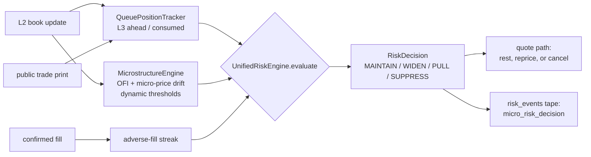

# Unified microstructure risk engine

One object now decides what happens to every resting quote: `UnifiedRiskEngine`
(`src/polymarketbot/risk/unified.py`). It replaces two independent detectors that
each answered the wrong question.

## What was wrong

| Issue | Evidence before |
|---|---|
| No queue position | Neither detector knew where our order sat in the FIFO queue. "The book moved" was treated as "our order will fill". |
| Dead second sentinel | `microstructure_no` was constructed (`live/base.py:189`) and updated every NO book frame (`live/engine/feed.py:50`), but no decision ever read it. |
| Hardcoded thresholds | `live/economics.py:48-49` passed `850.0` / `1.5c` into the sentinels, so the dynamic branch in `microstructure.py:311` never executed. `compute_dynamic_drift_threshold_cents` also defaulted `volatility=0.02`, identical to `volatility_ref`, making the input a no-op. |
| Reactive only | `ToxicityTracker` fired after **3 consecutive fills** — a loss limiter that acts after the losses. |
| Prints discarded in live | `on_trade_update` returned at `live/engine/feed.py:132-135` when not in dry-run, so a queue position could never advance in live trading. |
| Decisions not recorded | The predictive gate wrote `logger.warning` and emitted no event; the tape had no OFI/drift, queue position, or threshold. |

## Architecture



Both tokens are tracked independently: `feed.on_book_update` calls
`micro_risk.on_book(<that side's asset id>, ...)`, so the NO leg is evaluated on
the NO book rather than on the YES sentinel.

## Decision precedence

1. **Unmeasured** — no flow inputs yet (fewer than 8 distinct mids, or no
   `realized_volatility`) → `MAINTAIN`, `measured=False`. No provisional
   threshold is substituted.
2. **Adverse-fill streak** — the surviving reactive rule. `consecutive_fills_threshold`
   is a required constructor argument of `UnifiedRiskEngine` (no `RiskConfig` default;
   provenance must be stated by the caller) and decides when a side suppresses or widens.
3. **Toxic flow on the at-risk side**, in evidence order:
   1. measured economics: expected cost of being filled exceeds the spread
      capture forgone by pulling → `PULL`;
   2. no size ahead of us in the queue → `PULL`;
   3. the flow gate reports extreme → `PULL`;
   4. otherwise `WIDEN` by the measured drift.
4. **MAINTAIN** — queue priority is the income source.

The measured fill probability cancels out of 3.1 because both sides are
per-fill quantities, so the rule reduces to
`adverse_drift_per_share > spread_capture_per_share`, with no free parameter.

## Measured inputs

| Input | Source |
|---|---|
| Queue ahead / consumed fraction | L2 depth at our price, FIFO-monotone **inference** (`risk/queue_position.py`); the venue does not publish arrival order (`docs/limitations.md:96-128`), so records carry `queue_position_inferred=True` |
| OFI threshold | `compute_dynamic_ofi_threshold(bid_size, ask_size, c_depth=…, z_score=…, v_ref=…, beta_vol=…)` — depth/vol coefficients are tape-fitted into `data/derived/risk_calibration.json` and required; the method has no defaults |
| Drift threshold | `compute_dynamic_drift_threshold_cents(mid, spread, volatility=<realised daily vol>)` |
| Realised volatility | rolling 300 s log-return dispersion of the engine's own mids |
| Adverse drift / fill probability | `data/derived/ctf_maker_markout.json`, `data/derived/ctf_quote_fill_horizon.json` |

`live/economics.py` now defaults `ofi_threshold` / `drift_threshold_cents` to
`None`, which is what activates the dynamic path.

## Reading the tape

Every non-`MAINTAIN` decision is emitted as `micro_risk_decision` and routed to
the `risk_events` table of the live session tape:

```python
import pandas as pd, glob
rows = pd.concat(pd.read_parquet(p) for p in glob.glob("data/live_tape/*/risk_events/*.parquet"))
rows[rows.kind == "micro_risk_decision"][
    ["recv_ts_ns", "side", "action", "reason", "queue_ahead", "queue_ahead_at_entry",
     "ofi_10_events", "ofi_threshold", "drift_cents", "drift_threshold_cents", "measured"]
]
```

This is the table that makes the canary question answerable: lead time between a
detector firing and the adverse print, and the realised distribution of OFI /
drift against the thresholds that fired.

## Where the coefficients come from

`data/derived/risk_calibration.json` is fitted from the recorded tape by
`python -m polymarketbot.tools.fit_risk_calibration`:

| Field | Measured object |
|---|---|
| `c_depth`, `beta_vol`, `v_ref` | logistic trigger fit: `P(one-tick move in the flow's direction | |OFI|/d_harm, 24 h volume)`, inverted at P = 0.5; the linear impulse regression is reported alongside and is not identified on this tape |
| `z_score` | empirical quantile of the standardised 10-event OFI at the stated 5 % trigger budget |
| `pull_multiplier`, `widen_offset_multiplier` | grid search over a tape replay of pull vs widen, priced with `ctf_maker_markout.json` |
| `consecutive_fills_threshold` | run length of losing fills at which the next fill's measured net (capture - markout) turns negative |

`toxicity_action` remains policy. The economic rule is measured; the queue
position is an inferred quantity, and is labelled as such in the decision
record.

## Verification

```bash
uv run pytest tests/test_unified_risk_engine.py tests/test_queue_position.py \
  tests/test_live_risk_wiring.py tests/test_microstructure.py \
  tests/test_quote_lifecycle.py tests/test_risk_breaker_semantics.py -q

uv run python -m polymarketbot.live.runner --dry-run --duration 30 --no-clear
```
