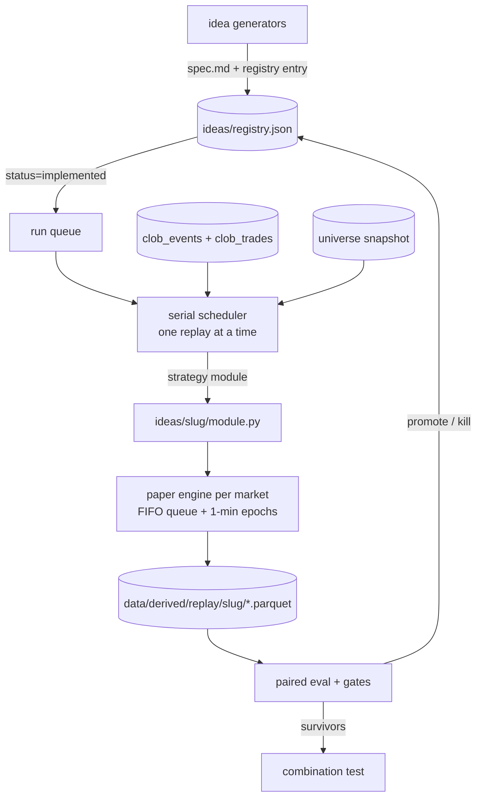

# Plan — automated strategy search on the full reward universe

The machine exists: a 45 GB tape of every book change and print across the
reward universe, a paper engine that simulates FIFO queues and 1-minute reward
epochs, and a measured fill model. This plan turns that machine into a loop that
tests hundreds of ideas without a human in the loop.

`roadmap.md` is how the infrastructure is built. `docs/two-week-data-plan.md` is
the data spec. This file is the **experiment factory**.

---

## 0. Constraints that shape every decision

| constraint | consequence |
|---|---|
| **One CPU** | Replays run **serially** in one scheduler. Parallel agents write code and search for ideas; they never run a replay at the same time. |
| **Tape only** | Every test replays recorded `clob_events` + `clob_trades`. No live WS in the loop, so a test is reproducible and a strategy cannot peek ahead. |
| **Rewards are paid on resting quotes, not fills** | A market with no events still pays if our quote is eligible. Performance has **two components**: reward yield (share of pool) and trading P&L (adverse selection). Both are measured; they are not the same number. |
| **10 minutes is a regime, not a day** | A 10-minute slice over ~500 active conditions gives thousands of fills, but they are correlated within a condition and within one market regime. Rankings use **paired per-condition diffs**, never raw totals. |
| **The universe is live, the manifest is stale** | The collector currently covers 2,152 markets and ~500 show book events per hour. The Nov-1 `manifest_locked_1028.json` overlaps only 266 of them. Tests use the **current** universe snapshot. |
| **Book tape records changes** | A market with no competitor activity has no rows. Those markets are modelled from the universe metadata (price, pool, min size, max spread) and are exactly where reward yield is highest and adverse selection is lowest. |

## 1. Architecture



Four components, each replaceable:

1. **`scripts/replay_all_markets.py`** — the harness. Universe → slice → one
   paper engine per market → per-market and aggregate metrics. Deterministic
   for a given slice and strategy.
2. **`src/polymarketbot/strategy/`** — the module protocol and the built-ins
   (`reactionary`, `queue_aware_ofi`). A module is pure: it sees a context
   object and returns per-side actions. No I/O, no network, no clock.
3. **`ideas/<slug>/`** — one directory per idea: `spec.md` (hypothesis, data,
   kill condition), `module.py` (the strategy), optional `prepare.sql`,
   `result.json`. **Nobody edits another idea's files.**
4. **`scripts/run_idea_queue.py`** — reads the registry, runs the next batch
   serially, writes results, flips statuses.

## 2. The all-markets harness

**Universe.** `--universe data/tape/universe/<latest>.json`, filtered by
`--min-pool` (default `15`). Every market registers both tokens.

**Capital and sizing.** Per market:

```
capital_i   = clamp(pool_multiplier * daily_pool_i, notional_min, notional_max)
shares_i    = max(rewards_min_size_i, capital_i / mid_i)
inventory_i = 3 * shares_i
```

Defaults `pool_multiplier=0.25`, `notional_min=10`, `notional_max=500`, so a
\$25/day market quotes ~\$10 and a \$3,000/day market quotes \$500. `--flat 500`
overrides the scaling for the "\\$500 on every market" configuration.

**Slice.** `--start-utc` + `--minutes`, default the last 10 minutes of the most
recent sealed hour. Books are replayed by applying `price_change` levels to a
per-asset ladder; `update_orderbook` is called when the top moves or every
`--requote-seconds` (default 1). Prints go to `on_trade`, which is the FIFO
queue simulation. `run_epoch_sample` is called once per simulated minute, so a
10-minute slice is 10 reward epochs.

**Outputs.** `data/derived/replay/<tag>/metrics.parquet` (one row per
strategy × condition), `fills.parquet` (every fill with its markout), and
`summary.json`. Ledgers per market under the same tag.

**Metrics, per market and aggregate**

| metric | definition |
|---|---|
| `fills`, `fill_notional` | FIFO-simulated fills and their notional |
| `cash_pnl` | realised P&L from the engine ledger |
| `inventory_mtm` | open inventory x final mid |
| `rewards_usd` | sum of 1-minute epoch payouts |
| `net` | `cash_pnl + inventory_mtm + rewards_usd` |
| `markout_5m_bps` | signed mid move 5 min after each fill, in bps of fill price |
| `time_quoted_frac` | fraction of seconds with at least one side resting |
| `score_share` | mean `S_ours / (S_ours + S_competitors)` per epoch |

**Budget.** ~1,028 markets x 2 tokens x 600 s ≈ 1.2 M book updates ≈ 40–150 s
per strategy at the measured 8–30 k updates/s. A first run of any new harness
gets 300 s; a slice that exceeds it is cut, not waited on.

## 3. Strategy module protocol

```python
class StrategyModule(Protocol):
    name: str
    def setup(self, market: MarketView) -> None: ...
    def on_book(self, ctx: BookContext) -> None: ...
    def on_trade(self, ctx: TradeContext) -> None: ...
    def decide(self, ctx: DecisionContext) -> SideActions: ...
```

`SideActions` is `(bid_action, ask_action)` with action in `QUOTE`, `SHRINK`,
`PULL` and a `size_scale` in `[0, 1]`. `decide` is called after every book
update, exactly where `QuoteOrchestrator.decide` sits today; the built-in
`queue_aware_ofi` module *is* the current orchestrator wrapped in the protocol,
so the harness can reproduce known numbers before it tests anything new.

Rules for modules:

- Read only the context (book, queue ratio, own inventory, measured signals).
  Never read the tape ahead, never use wall-clock time.
- Return actions; the engine owns sizing floors, post-only clamping and risk.
- Any state is per market and reset by `setup`.
- A module that needs new data ships a `prepare.sql` that materialises it into
  `data/derived/ideas/<slug>/`, built from the tape in a separate step.

## 4. Idea pipeline

**Generator.** One agent (a second when the backlog drops below 5) that writes
ideas until the quota is met. Quota, not infinity: **80 specs**, then it
consolidates and dedupes. Each spec is 15 lines: claim, mechanism, data needed,
module sketch, kill condition, what result would change our mind. Sources must
be cited (paper, venue docs, observed pattern in our data).

**Dedupe.** An idea is a duplicate if its `mechanism` field matches an existing
one at the level of "what moves the price and why we get paid". Different
parameter values are not new ideas.

**Status machine**

```
proposed → data_ready → implemented → queued → running → done
                                    ↘ killed (with reason)
                                    ↘ inert  (no decision ever changed)
```

`inert` is a verdict, not a pass: a module whose actions never changed the
baseline's quotes was never tested. The scheduler detects it (identical net on
every condition) and the fix is a missing signal or a trigger condition that
cannot hold under inside-spread quoting.

**Frozen slice.** All comparisons in one table must share a slice. The scheduler
accepts `--start-utc`; a run that silently moves the slice produces numbers that
cannot be compared with the previous wave, so the slice is recorded in every
`result.json` and in the results doc.

`killed` is a first-class outcome. An experiment factory whose ideas never die
is measuring nothing.

**Spec template** (`ideas/_template/spec.md`)

```
# <title>
claim:      <one sentence, falsifiable>
mechanism:  <why the counterparty loses / why the pool underpays us>
data:       <tables, fields, window>
module:     <what decide() does, in one paragraph>
metric:     <the number that decides it>
kill:       <the result that ends this line of work>
```

## 5. Agent swarm protocol

| role | count | writes | never touches |
|---|---|---|---|
| idea generator | 1–3 | `ideas/<new>/spec.md`, registry `proposed` | code, tape, other ideas |
| implementer | 1 per idea | `ideas/<slug>/module.py`, `prepare.sql` | other slugs, shared engine |
| scheduler | 1 (script) | `data/derived/replay/*`, registry status | code |
| integrator | 1 | `src/polymarketbot/strategy/`, harness fixes | idea internals |

Rules:

- **One compute job at a time.** The scheduler owns the CPU; agents may run
  unit tests (seconds), never a replay.
- **Interface first.** The registry entry names the module path and the metric;
  the harness never imports anything outside `ideas/`.
- **Every idea gets its own slice hash.** Two ideas compared on different
  slices are not compared; the harness refuses mismatched slices unless
  `--allow-unpaired`.
- **An agent may not promote its own idea.** Promotion is a gate statistic, not
  an opinion.

## 6. Experiment design and statistics

- **Paired, per condition.** For every condition, compute the strategy's net and
  the baseline's net on the *same* slice; test the mean of the differences with
  a t-stat that uses the condition as the unit. Sign tests as a cross-check
  (robust to fat tails).
- **Two baselines.** `reactionary` (quote both, no gate) and
  `queue_aware_ofi` (the current production candidate). Beating reactionary is
  necessary; beating queue_aware is what earns a promotion.
- **Both P&L components reported separately.** Never present `net` without
  `rewards_usd` and `marks` next to it.
- **Regime split.** Each slice is labelled by hour bucket and by whether the
  condition's book was active; a strategy that only wins in one bucket is
  reported as such.
- **Promotion gates.**
  1. ≥ 200 fills across ≥ 50 conditions, or ≥ 50 conditions and a reward-only
     claim with `time_quoted_frac > 0.9`.
  2. Paired mean net > 0 with t ≥ 2.0 on the condition unit, on **two
     non-overlapping slices**.
  3. `markout_5m_bps` not worse than the baseline by more than its standard
     error.
  4. No single condition contributes > 25 % of the total (concentration check).
- **Combination test.** Survivors are stacked with `CompositeStrategy`
  (`src/polymarketbot/strategy/composite.py`): per side the most conservative
  action wins, the smallest scale survives, and the first explicit price is
  kept, so a stack can only tighten a quote and never adds exposure. Report
  leave-one-out contribution per module on the same slice; a combination must
  beat its best member, else the members are redundant and stay separate.

## 7. Autonomy loop

One cycle, repeated:

1. Generator tops the backlog up to its quota.
2. Scheduler runs every `implemented` idea on slice *A* (10 min), serially.
3. Evaluator writes the paired table; ideas that fail gate 2 on *A* are killed
   or flagged `needs_data`.
4. Survivors run on slice *B* (a different hour, same day) and on a longer
   60-minute slice.
5. Survivors and the two baselines run as a combination.
6. Registry, `docs/results-log.md`, and the replay tag are committed with the
   numbers, so a later agent can audit every claim.

Budget per cycle: ≤ 40 idea-minutes of replay (each run 1–3 min), so a cycle is
~2 hours of wall clock on this machine.

## 8. Milestones

| # | deliverable | done when |
|---|---|---|
| 1 | all-markets harness | reproduces `reactionary` and `queue_aware_ofi` numbers on a 10-min slice, one command, ≤ 300 s |
| 2 | strategy protocol + built-ins | `--strategy` selects any module in `ideas/`; engine untouched for a new idea |
| 3 | idea registry + 20 specs | generated, deduped, each with a kill condition |
| 4 | first wave of 5 ideas | implemented and queued, each with its own result row |
| 5 | paired evaluation report | `docs/replay-results.md` with the two baselines and the wave |
| 6 | combination test | leave-one-out table over the survivors |
| 7 | promotion to the live gate shortlist | gate 8 checklist updated with the winning module |

## 9. Risks and kill criteria

- **Slice overfitting.** Ten minutes of one hour is one regime. Gate 2 (two
  slices) exists for this; a strategy that cannot survive it is killed, not
  tuned.
- **Reward model approximation.** `compute_epoch_payout` uses the observed
  competing score from the tape. Where the book tape is silent, competition is
  unknown, not zero: those markets are flagged `unobserved_competition` and
  their reward numbers are reported separately, never mixed into the aggregate.
- **Tape gaps.** A condition with no `book` snapshot inside the slice starts
  from the first `price_change` top; if that is absent too, the market is
  skipped and counted, not silently filled with a default price.
- **Agent drift.** Any module that reads outside its context, or a result whose
  slice hash does not match the recorded one, is rejected by the harness.
- **The endpoint.** After the quota of ideas, the deliverable is a ranked list
  of capacity-checked strategies with their measured numbers — not a single
  backtest and not a promise.
