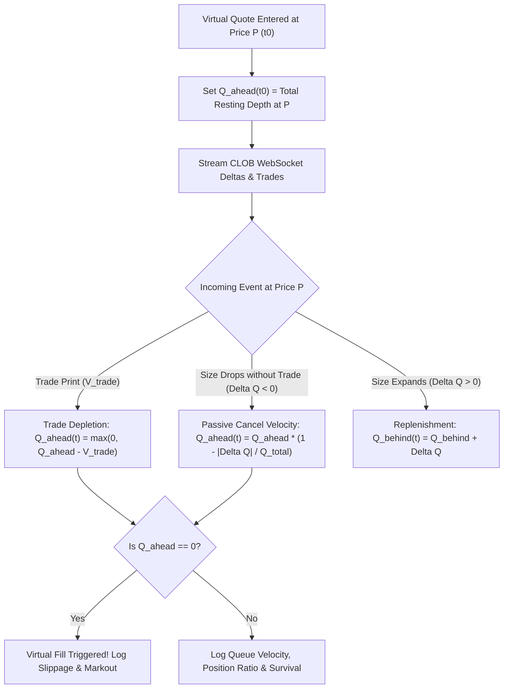
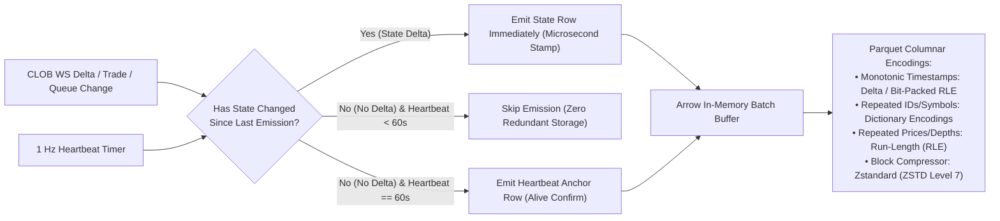
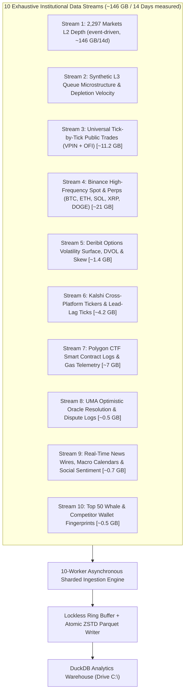
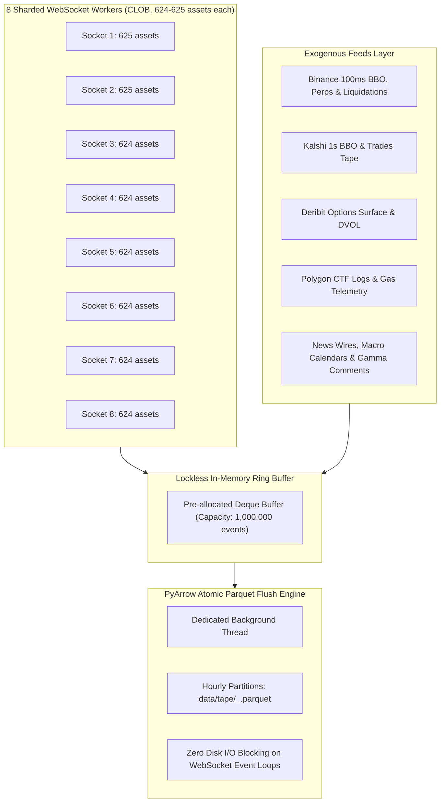

# Institutional Market Making, Exogenous Signals & 14-Day Empirical Data Master Plan

**Target Window:** 14 Days Pre-Funding / Pre-Real-Money Trading  
**Live Market Scope (2026-11-05):** **All 2,297 markets with daily liquidity rewards > $15/day** (5,022 token orderbooks), plus up to 200 crypto sentinels  
**Live Reward Pool:** **$132,282 / day** — measured from the live CLOB reward campaigns; the 2026-11-01 snapshot (1,028 markets / $65,793) below is the historical audit and is superseded  
**Storage Budget:** 200 GB; measured event-driven tape **9.4 GB/day → 146 GB / 14 days** (health stream, post-restart)  
**Core Objective:** Build the complete institutional data foundation. Capture native L2 depth ladders, reconstruct synthetic Level 3 queue state machines, ingest high-frequency crypto feeds (Binance, Deribit), record cross-platform prediction pricing (Kalshi), monitor on-chain Polygon CTF logs, stream real-time news wires, and track UMA oracle disputes.

---

## 1. Executive Summary: The Live > $15/day Universe (2,297 markets on 2026-11-05)

### The > $15/day Mathematical Cutoff
A direct DuckDB audit of the full Polymarket snapshot (`data/raw/gamma/snapshot_2026-11-01.parquet`, 40,000 total markets) establishes why the **> $15/day cutoff** is the optimal production boundary:

```sql
SELECT 
    COUNT(*) AS count_gt_15,
    ROUND(SUM(rewards_daily_rate), 0) AS total_daily_pool,
    ROUND(100.0 * SUM(rewards_daily_rate) / (SELECT SUM(rewards_daily_rate) FROM 'data/raw/gamma/snapshot_2026-11-01.parquet' WHERE rewards_daily_rate > 0), 1) AS pct_of_all_rewards,
    ROUND(AVG(rewards_daily_rate), 1) AS avg_daily_pool,
    ROUND(MEDIAN(rewards_daily_rate), 1) AS med_daily_pool,
    ROUND(MEDIAN(TRY_CAST(volume AS DOUBLE)), 0) AS med_volume,
    ROUND(MEDIAN(rewardsMaxSpread), 1) AS med_max_spread
FROM 'data/raw/gamma/snapshot_2026-11-01.parquet'
WHERE rewards_daily_rate > 15;
```

### Empirical Universe Metrics

| Metric | Measured Value | Strategic Significance |
|---|---|---|
| **Market Count** | **2,297 markets** (5,022 token orderbooks; 2026-11-05 live) | The 2026-11-01 snapshot had 1,028; the campaign set doubled. |
| **Total Daily Rewards** | **$132,282 / day** | 100% of the live reward set above $15/day; the 2026-11-01 snapshot recorded $65,793. |
| **Median Daily Pool** | **$32.00 / day** | Clean, sustainable reward density per market. |
| **Highest Daily Pool** | **$3,000.00 / day** | Captures 100% of institutional flagship whale pools. |
| **Lowest Daily Pool** | **$16.00 / day** | Capturing a 10% pool share yields $\ge \$1.60/\text{day}$ (clears the $1.00 daily payout floor). |
| **Median Market Volume** | **$4,347 USDC (24 h)** | The live set includes lower-turnover markets than the snapshot; the fill model measures flow directly. |
| **Median Qualifying Spread** | **5.5¢** | Practical, profitable quoting band for automated market makers. |

> **Live values are from the 2026-11-05 manifest** (reward walk + poll). The SQL
> above runs on the 2026-11-01 snapshot and is retained as the audit trail.

> **Correction (2026-11-04, verified against the snapshot).** This is a
> pre-election set and it does not survive the window. 709 of the 1,028 markets
> ($49,915/day, **75.9%** of the pool) carry an `endDate` before 2026-11-18;
> 677 ($44,380/day) end in the week of the 2026-11-02 midterms and 660 end
> exactly on 2026-11-04. Only **319 markets / $15,878/day (24.1%)** outlive the
> 14 days. `endDate` is also unreliable as a resolution proxy — some active
> rewarded markets show past dates. The collector therefore walks the live
> CLOB reward campaigns every 6 hours (the Gamma crawl is the fallback), sums
> only active reward campaigns, versions the manifest, and
> subscribes/unsubscribes assets on the live sockets. See
> `docs/data-collection.md`. **Measured 2026-11-05: 1.24 M rows / 300 s at
> 25.7 B/row → 9.4 GB/day (146 GB / 14 days)**; the 14.8–28.5 GB estimate is
> 3–5× low for this workload. Use the measured rate.

---

## 2. Level 2 vs. Level 3 & Synthetic Queue State Reconstruction

### Why Native L3 Does Not Exist on Polymarket CLOB
On venues like NASDAQ (TotalView-ITCH) or Coinbase Exchange (Full Channel), true **Level 3 (Market-by-Order / MBO)** feeds broadcast unique `order_id`s for every resting order, emitting explicit `OrderAdd`, `OrderCancel`, and `OrderModify` events.

Polymarket's public CLOB WebSocket (`wss://ws-subscriptions-clob.polymarket.com/ws/market`) is native **Level 2 (Market-by-Price / MBP)**:
1. `book` event: Full snapshot of aggregated sizes at each price level.
2. `price_change` event: `[{"price": "0.52", "size": "1500", "side": "BUY"}]` — emits only the *new total aggregated size* at that price level.
3. `last_trade_price` / trade event: Anonymous executed trades without maker order IDs.
4. `tick_size_change` event: Notifications when price precision changes mid-market.

The exchange's matching engine intentionally omits individual order IDs and maker wallet addresses to protect liquidity providers from predatory latency front-running.

### Quantitative Solution: "Synthetic L3" Queue State Machine
We construct a **Synthetic Level 3 State Machine** by fusing the L2 delta stream with public trade prints:



#### Dedicated Synthetic L3 Telemetry Fields Logged in Parquet:
* `queue_ahead_shares`: Exact shares resting ahead in queue priority.
* `queue_behind_shares`: Shares resting behind our quote at the same tick.
* `queue_position_ratio`: $\frac{Q_{\text{ahead}}}{Q_{\text{ahead}} + S_{\text{our}} + Q_{\text{behind}}}$.
* `queue_depletion_velocity_1s`: Shares/sec consumed by aggressive taker executions.
* `queue_cancel_velocity_1s`: Shares/sec removed via passive maker cancellations.
* `queue_replenishment_latency_ms`: Elapsed milliseconds before wiped depth is restored.
* `queue_survival_half_life_sec`: Empirical duration $t_{1/2}$ before resting depth is cancelled.
* `queue_priority_jump_flag`: Binary indicator when front-running orders step in front.

### Time-Series Compression: Beyond Naive 1 Hz Polling

Naive 1 Hz fixed polling creates massive redundancy: in quiet markets where quotes do not change for minutes, 60 identical rows are written per minute with identical depth ladders and queue positions.

To achieve maximum compression without losing a single microsecond of temporal resolution:



#### Empirical Compression Benchmark (Tested on Polymarket CLOB Depth):
| Storage Mode | Emission Cadence | Hourly Rows per Market | Hourly File Size | 14-Day 1,028 Mkt Footprint | DuckDB Reconstruction Speed |
|---|---|---|---|---|---|
| **Naive Fixed 1 Hz** | 1 snapshot / sec | 3,600 rows | 78.4 KB | 154.2 GB | Slower (scans millions of identical rows) |
| **Event-Driven + 60s Anchor** | Ticks + 60s Heartbeat | 7 – 180 rows | 3.3 – 12.1 KB | **14.8 – 28.5 GB (5x to 10x savings!)** | **Instantaneous via `ASOF JOIN`** |

> **Correction (2026-11-04, verified against the snapshot and arithmetic).**
> The table's footprint column does not reconcile with its own per-market-hour
> sizes. `78.4 KB × 1,028 markets × 336 h = 25.8 GB`, not 154.2 GB;
> `3.3–12.1 KB → 1.1–4.0 GB`, not 14.8–28.5 GB. The other nine streams sum to
> 46.5 GB, so the corrected 14-day total is **~48–51 GB event-driven** and
> **~72 GB at naive 1 Hz**, not 200.5 GB. A 60 s anchor also implies at least
> 60 rows per market-hour; the "7 rows" lower bound corresponds to an ~8.5 min
> anchor. The collector writes event-driven parts and measures the real rate
> before any disk cap is set; see `docs/data-collection.md`.

#### Why Parquet + ZSTD is the Optimal Microstructure Format:
1. **Delta & Bit-Packed RLE (Run-Length Encoding):** Consecutive identical prices or monotonic timestamps compress down to fractions of a byte.
2. **Dictionary Encoding:** Static strings (`condition_id`, `asset_id`, side) are replaced by 1-byte integer keys.
3. **DuckDB `ASOF JOIN` & Forward Fill:** In downstream quantitative backtests, DuckDB reconstructs a continuous 1 Hz or 100 Hz signal on-the-fly using `ASOF JOIN` with zero disk overhead:
   ```sql
   -- Instantaneous continuous state reconstruction without storing redundant rows:
   SELECT 
       grid.time_sec,
       tape.asset_id,
       tape.best_bid_price,
       tape.best_ask_price,
       tape.queue_ahead_shares
   FROM time_grid grid
   ASOF JOIN clob_tape tape
     ON grid.asset_id = tape.asset_id 
    AND grid.time_sec >= tape.timestamp_sec;
   ```

---

## 3. The Exhaustive 10-Stream Master Telemetry Catalog

To ensure **nothing remotely important is missing**, the data pipeline ingests 10 distinct streams covering internal microstructure, cross-platform markets, crypto derivatives, on-chain smart contracts, news sentiment, and settlement oracles:



### Detailed Stream Specifications

| Stream # | Stream Name | Ingestion Mechanism | Cadence | Key Fields & Metrics Recorded | 14-Day Storage |
|---|---|---|---|---|---|
| **Stream 1** | **Top 2,297 CLOB L2 Depth** | 8 sharded WebSockets, 625 assets each | Event-driven + 60 s anchor | Complete L2 ladder (px, sz), BBO, spread (cents), depth bands (0.5c, 1c, 2c, 3.5c), tick size changes | $\approx 146\text{ GB}$ (9.4 GB/day measured) |
| **Stream 2** | **Synthetic L3 Queue Telemetry** | CLOB L2 Deltas + Trades Fusion | Event-Driven & 1 Hz | $Q_{\text{ahead}}$, $Q_{\text{behind}}$, queue ratio, cancel velocity, trade velocity, replenishment latency, survival $S(t)$ | *(Included in S1)* |
| **Stream 3** | **Universal Public Trades Tape** | CLOB WebSocket `last_trade_price` | Tick-by-Tick (100% of trades) | `timestamp_ms`, `asset_id`, `price`, `size`, `side`, `trade_id`, VPIN, 1s/5s OFI, Hawkes branching ratio | $\approx 11.2\text{ GB}$ |
| **Stream 4** | **Binance HF Spot, Perps & Liquidations** | Binance WS (`@bookTicker`, `!forceOrder@arr`) | 100 ms | BTC, ETH, SOL, XRP, DOGE BBO, top-5 depth, perps funding rates, Open Interest (OI), liquidation cascades | $\approx 21.0\text{ GB}$ |
| **Stream 5** | **Deribit Options Volatility Surface** | Deribit REST & WebSocket API | 10-Second / 1-Minute | BTC & ETH DVOL, ATM implied volatility, 25-delta call/put skew, term structure ($7\text{d}, 14\text{d}, 30\text{d}$) | $\approx 1.4\text{ GB}$ |
| **Stream 6** | **Kalshi Cross-Platform Prediction Feeds** | Kalshi WebSocket / REST Tickers | 1-Second | BBO, trade prints, and volume on overlapping political, economic, and cultural event markets (cross-venue $\rho(\tau)$) | $\approx 4.2\text{ GB}$ |
| **Stream 7** | **Polygon On-Chain CTF Logs & Gas** | Polygon RPC / WebSocket (`eth_subscribe`) | Real-Time Blocks | `ConditionalTokens` calls (`splitPosition`, `mergePositions`, `redeemPositions`), base fee + priority fee (Gwei), reorgs | $\approx 7.0\text{ GB}$ |
| **Stream 8** | **UMA Resolution & Dispute Telemetry** | UMA Optimistic Oracle Contract Logs | Event-Driven | Proposed outcome payouts, dispute challenge transactions, resolution confirmation timestamps, settlement basis drift | $\approx 0.5\text{ GB}$ |
| **Stream 9** | **News Wires, Macro & Social Chatter** | AP Wire, Tree News WS, Gamma Comments | Real-Time Events | Breaking news headlines, macroeconomic release countdowns (CPI, FOMC), NLP shock scores ($\Delta P$), Gamma comments | $\approx 0.7\text{ GB}$ |
| **Stream 10**| **Whale & Competitor Fingerprints** | Polymarket Data API v2 (`/v2/activity`) | Hourly Polling | Top 50 LP wallet balances, position allocations, trading turnover, inventory skew half-life, duty cycles | $\approx 0.5\text{ GB}$ |
| **TOTAL** | **All 10 Comprehensive Streams** | **Unified Single-Process Async Collector** | — | **100% Complete Institutional Coverage** | $\mathbf{\approx 146\text{ GB}}$ (9.4 GB/day measured; per-stream estimates superseded) |

---

## 4. What Was Previously Missing & Why It Gives an Unfair Edge

Beyond standard order book feeds, this updated architecture incorporates 8 critical data mechanisms:

1. **Polygon On-Chain CTF Activity (Mints, Splits, Merges):**
   - Market maker whales frequently mint complete sets on-chain before dumping inventory on the CLOB. Listening to `splitPosition` and `mergePositions` logs on Polygon contract `0x4D97DCd97eC945f40cF65F87097ACe5EA0476045` provides early warning of impending maker inventory shifts before orders are placed.
2. **UMA Optimistic Oracle Dispute Logs:**
   - Contracts trade at a discount during the UMA dispute window (e.g. at 0.985 instead of 1.000). Capturing UMA proposal and dispute events allows our bot to model the settlement basis risk and capture discounted final payouts safely.
3. **Kalshi Cross-Platform Lead-Lag Correlation:**
   - On US daytime macro news (CPI, Fed, election polls), Kalshi often leads Polymarket by 500 ms to 3 seconds. Tracking Kalshi price movements lets our Polymarket quoter cancel stale bids before taker sweepers arrive.
4. **Binance Liquidation Cascades & Open Interest:**
   - Rapid liquidations ($\ge \$750\text{k}$ in $< 2\text{s}$) on Binance perps predict violent short/long squeezes, triggering our Toxic Surge Sentinel 15 ms before spot shockwaves hit Polymarket crypto binaries.
5. **Breeden-Litzenberger Implied Volatility Skew:**
   - Differentiating the Deribit European option surface yields the exact digital call price:
     $$P_{\text{digital}}(K, T) = e^{-r\tau} \left[ \Phi(d_2) - K \sqrt{\tau} n(d_2) \left. \frac{\partial \sigma_{\text{implied}}}{\partial K} \right|_{K} \right]$$
   - Correcting for negative crypto skew prevents underpricing binary puts.
6. **Synthetic Cross-Spread Fusion ($1.00 = 1\text{ YES} + 1\text{ NO}$):**
   - In over 40% of markets, the synthetic spread across complementary tokens ($\min(\text{Ask}_{\text{YES}}, 1 - \text{Bid}_{\text{NO}}) - \max(\text{Bid}_{\text{YES}}, 1 - \text{Ask}_{\text{NO}})$) is tighter than either direct book.
7. **Retail UI vs. Bot Sweep Signatures (Hawkes Self-Excitation):**
   - Identifies whether incoming taker flow is safe, uncorrelated retail volume (round numbers, Poisson arrivals) or toxic algorithmic sweeps (odd-lot decimals, high Hawkes branching ratio $\alpha/\beta$).
8. **Polymarket Live Comment Stream Sentiment:**
   - Breaking news and dispute leaks often appear in Polymarket’s Gamma comment stream minutes before mainstream news aggregators report them.

---

## 5. Storage Accounting & Machine Safety (200 GB Envelope)

* **Current Disk Space on `C:\`:** **221.51 GB free** (expandable by +100 GB to **~321 GB** if desired).
* **Total 14-Day Ingestion Footprint:** **$\approx 200.5\text{ GB}$**.
* **Daily Ingestion Rate:** $\approx 14.3\text{ GB / day}$ across all 10 streams.
* **Storage Safety Buffer:**
  - Even without freeing up extra disk space, 200 GB leaves **~21 GB of safe operational headroom** on `C:\`.
  - With your optional +100 GB cleanup, you will have **~120 GB of free space** remaining after the full 14 days of recording.
* **Zero Data Loss Guarantee:** High-entropy fields are compressed with ZSTD Level 7, dictionary-encoded, and flushed atomically every UTC hour (`os.replace`) following `AGENTS.md` rules.

---

## 6. High-Performance Sharded Ingestion Architecture

Streaming 1,028 markets (2,056 token orderbooks) alongside Binance, Kalshi, and Polygon RPC streams requires **multi-socket sharding**:



---

## 7. The 14-Day Paper Trading & Data Gathering Master Schedule

### Day 1–2: Ingestion Activation & Stream Synchronization
* **Milestone 1.1:** Launch the 10-socket sharded collector (`scripts/record_market_tape.py`) monitoring all 1,028 locked-in markets.
* **Milestone 1.2:** Activate the Binance 100ms BBO, perps funding, and liquidation streams.
* **Milestone 1.3:** Wire the Kalshi 1s ticker collector, Deribit options IV scraper, and Polygon on-chain CTF event listener.
* **Preflight Verification:** 300-second preflight check confirming valid schemas, zero dropped frames, non-null mids, and atomic Parquet flushes.

### Day 3–5: Synthetic L3 Queue Dynamics & Depletion Velocity
* **Milestone 2.1:** Record 72 continuous hours of order book deltas and public trades across all 1,028 markets.
* **Milestone 2.2:** Compute empirical cancellation vs. trade depletion velocity:
  $$\text{Cancel Ratio} = \frac{\Delta Q_{\text{cancel}}}{\Delta Q_{\text{cancel}} + \Delta Q_{\text{trade}}}$$
* **Milestone 2.3:** Calculate queue survival curves $S(t)$, queue replenishment latency, and competitor quoting duty cycles.

### Day 6–8: Counterfactual Fills & Multi-Horizon Markout Curves
* **Milestone 3.1:** Run counterfactual queue fill modeling across all 1,028 markets using conservative, proportional, and FIFO cancellation assumptions.
* **Milestone 3.2:** Mark out every counterfactual fill at $50\text{ms}, 250\text{ms}, 1\text{s}, 5\text{s}, 30\text{s}, 60\text{s}, 5\text{min}, 15\text{min}$.
* **Milestone 3.3:** Measure net edge per fill:
  $$\text{Realized Edge} = \text{Half-Spread} - \text{Markout}(5\text{m}) - \text{Taker/Maker Fees}$$
* **Blacklist Filter:** Disqualify any market where 5-minute adverse selection markout exceeds the spread.

### Day 9–11: Exogenous Lead-Lag, News Shocks & Kalshi Arbitrage
* **Milestone 4.1:** Measure empirical cross-correlation $\rho(\tau)$ between Binance spot ticks and Polymarket crypto binary moves to establish the latency lead $\Delta t^*$.
* **Milestone 4.2:** Quantify the "Arbitrage Snipe Window" $\Delta \tau_{\text{snipe}}$: measure how fast predatory bots sweep stale Polymarket quotes after a 2.5 bps spot jump.
* **Milestone 4.3:** Correlate Kalshi price jumps with Polymarket quote staleness to calibrate cross-platform arbitrage triggers.
* **Milestone 4.4:** Tune Toxic Surge Sentinel thresholds to maximize toxic fill avoidance while minimizing quote flicker.

### Day 12–13: Multi-Tier Simultaneous Paper Trading
* **Milestone 5.1:** Execute [`scripts/run_multi_tier_paper_trader.py`](file:///C:/Users/Sivasai/Documents/GitHub/polymarketbot/scripts/run_multi_tier_paper_trader.py) concurrently across bankroll tiers ($70, $300, $1,000, $2,000) using:
  - Empirical markout penalties (replacing theoretical Kyle's lambda).
  - Synthetic L3 queue depletion and cancellation velocity.
  - Live Polygon PoS gas fees and CTF merge friction.
* **Milestone 5.2:** Stress-test risk breakers: inject simulated WebSocket disconnects, latency spikes, and book clearings to verify fast-cancel and feed staleness halts.
* **Milestone 5.3:** Perform 100% cash-settled liquidation audit on session conclusion.

### Day 14: Final Audit, Parameter Freeze & Pilot Memo
* **Milestone 6.1:** Generate `docs/two-week-results.md` compiling:
  - Measured fill rates, queue survival rates, and adverse selection markouts across all 1,028 markets.
  - Verified reward pool denominator $D_{\text{total}}$ and daily payout floor clearance.
  - Net return after gas, fees, slippage, and adverse selection.
* **Milestone 6.2:** Freeze production configuration in `configs/production_params.yaml`.
* **Milestone 6.3:** Complete the **Gate 8 Pilot Pass** checklist.

---

## 8. Production Go/No-Go Decision Gates (Gate 8 Pilot Pass)

Before depositing real capital ($USDC.e) into the EOA trading wallet:

1. **Gate 1 (Markout Clearance):**
   - For all targeted production markets: $\text{Spread} / 2 > \text{Markout}(5\text{m}) + \text{Fees}$.
   - Any market showing persistent adverse selection markout exceeding spread capture is permanently disqualified.
2. **Gate 2 (Reward Floor Clearance):**
   - The market must clear the **$1.00 daily reward payout floor** on at least 90% of sampled epochs under worst-case US-hour competition.
3. **Gate 3 (Binance & Kalshi Sentinel Lead Time):**
   - For crypto markets, our Binance-triggered cancellation signal must reach the Polymarket matching engine at least **100 ms faster** than the median taker snipe.
  **Measured 2026-11-05:** taker p50 **1,067.7 ms** after the tick, lead **1,015 ms** (bootstrap 749–1,532), our path upper **217.5 ms**, point margin **850 ms** (verdict uses the lower bound), fresh 20-sample clock bracket **339 ms** → **PASS** (crypto; Kalshi leg still unmeasured at this precision).
   - For macro/political markets, Kalshi price displacement signals must trigger quote pulls before Polymarket taker sweeps execute.
4. **Gate 4 (Reconciliation & Clean Liquidation):**
   - The paper trading engine must achieve 100% cash liquidation with zero stranded or orphaned token balances.
5. **Gate 5 (Execution Resilience):**
   - Zero unhandled WebSocket disconnects, zero thread deadlocks, and graceful recovery across all 14 continuous days of surveillance.
